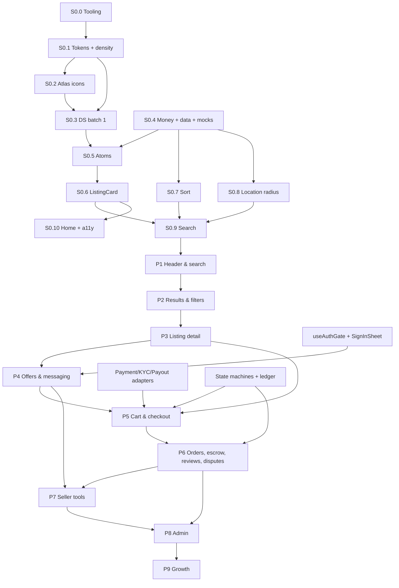

# WorldStreet Marketplace — Build Plan

Status: **approved 6 Oct 2026** (Q1–Q4 answered in §7) · Repo: `~/marketplace` → GitHub `omotomiyedavid15-afk/worldstreet`

**Inputs read in full:** `worldstreet-marketplace-ux-blueprint.md` (audit F1–F17, scorecard 3B), `worldstreet-ux-flows.md` (Parts A–L), `worldstreet-ebay-component-spec.md` (Sections 0–19, Parts I–XI), the live design system at https://worldstreet-design-system.vercel.app (Home, Foundations, Components, Patterns, Icons, Motion: page text, 53 code samples and the compiled CSS), and the `@vectoricons/atlas-icons-react` package.
**Direction from you (6 Oct):**
- Do not use the nagoya design sandbox.
- The live site is the design system: rebuild it in this repo and use its components.
- Icons come from **Atlas Icons**.
- **Components mirror eBay** (anatomy, information order, behaviour and wording such as "Pre-owned", "or Best offer", "+₦2,500 delivery", "99.2% positive (1,284)", "64 sold"), **styled with the WorldStreet design system** (tokens, Manrope, DS chips, buttons and surfaces). Where eBay and an accessibility rule disagree, accessibility wins and the deviation is logged.

---

## 1. What I found

### 1.1 This repo (`~/marketplace`)
| Item | State |
|---|---|
| Framework | Next.js **16.3.8** (App Router), React 19.2.8, TypeScript 5, Tailwind CSS 4 (PostCSS), ESLint 9 + `eslint-config-next` |
| Content | Untouched `create-next-app` scaffold: `app/layout.tsx`, `app/page.tsx`, `app/globals.css` (Geist fonts) |
| Tests / Storybook / CI | None |
| Git | `main` = scaffold commit `f3c7015`. This plan is on branch `plan/marketplace` (local, not pushed) |
| Install note | npm 12 blocks install scripts that aren't allowlisted (`unrs-resolver` is blocked; harmless for now). Some tools we add (Playwright browsers, Storybook) may need `npm install-scripts approve <pkg>` |

### 1.2 The design system (live site)
| Item | Finding |
|---|---|
| Source code | **Not available.** It's a deployed Next.js site; its React source (`@/components/ui`) is not public, not on disk, and not in your public GitHub repos. What *is* available: the compiled CSS (~106 KB, 301 `--cx-*` declarations, ~100 `.cx-` class families) and 53 code samples that document each component's props |
| Brand mechanism | The base theme is **"Cryonix": ember `#d32800` (red-orange)**. WorldStreet gold only applies under **`data-brand="worldstreet"`**, which remaps `--cx-ember → --ws-gold #eab308` and stone surfaces. **Without that attribute the app renders red-orange.** |
| Light theme | `[data-theme="light"]` under the brand: gold fill becomes `#efbe04` (not `#EAB308`), gold text is `--ws-gold-deep #a16207`, muted text `#78716c`, gain `#047857`, loss `#b91c1c`, warning `#b45309` |
| Dark theme | Default (`<html data-theme="dark">`). Muted `#a8a29e`, gain `#10b981`, loss `#ef4444` |
| Type | Manrope via `--font-manrope`. Scale H1 64, H2 52, H3 32, H4 22, Lead 20, Body-lg 18, Body 16, Small 14, **Caption 12**, Balance clamp(40–56) |
| Space | `--cx-s-1…13` = 4, 8, 12, 16, 20, 24, 32, 40, 48, 64, 80, 100, 120. Container 1320, gutter 30, card pad 24, gap 24, sidebar 264 |
| Radius | xs 6, sm 8, icon 12, md 16, **card 20**, lg 30, **pill 100** |
| Motion | `--cx-ease` (.22,1,.36,1), fast 140 ms, default 240 ms, slow 600 ms, reveal 900 ms, springs `--cx-spring`, `-snappy`, `-bouncy` (CSS `linear()`). Reduced-motion rules on 7 blocks |
| Components (code samples) | Accordion, Alert, AmountInput, Avatar, Badge, Breadcrumbs, Button (solid/ghost/quiet/danger, `arrow`), Card (`orb`), Checkbox, Chip (tones gain/loss/warning/brand, `dot`), CopyField, DeltaChip, Drawer, EmptyState, Field (`label`/`help`/`error`/`optional`), Input, Modal, OtpInput, Pagination, Progress, Range, Select, Skeleton, Stat (`sparkline`), Steps, Switch, Tabs, Textarea, ToastViewport + `toast()` |
| Class-only components | Table (`.cx-table`), List (`.cx-list-row`), Choice card, Date picker (`.cx-cal`), File upload, Inline input, Menu, Popover, Tooltip, Top nav, Sidebar, Bottom nav, Marquee, Icon tile |
| Patterns / Motion | Aurora, AuroraChart, SpotlightCard, PayCard, AmountDisplay, Actions/Action, Limit · Reveal, RollingNumber, WordReveal, TiltCard, Magnetic, `useCircleTransition` |
| Breakpoints | 768 and 1200 per the docs. The site's own CSS also uses 640, 900 and 999 internally. We won't add new breakpoints |
| Contrast (measured) | Muted on dark card 6.9:1 · muted on white 4.8:1 · gold-deep on white 4.9:1 · ink on gold 9.1:1 · gain light 5.5:1 · loss light 6.5:1 · warning light 5.0:1. **All pass AA** |

### 1.3 Atlas Icons (`@vectoricons/atlas-icons-react` 0.0.10, ISC)
- 2,660 icons, props `size`, `color`, `weight: thin | medium | bold`, `className`.
- Covers the marketplace: `Heart`, `Cart`, `ShopBag`, `Store`, `DeliveryTruck`, `Lorry`, `Bike`, `MagnifyingGlass`, `Filter`, `Sliders`, `Grid`, `List`, `Bell`, `Star`, `Location`, `Map`, `Camera`, `Image`, `QrCode`, `CreditCard`, `CreditCardShield`, `Wallet`, `DiscountTag`, `TicketCoupon`, `Tag`, `Share`, `Flag`, `Eye`, `Clock`, `Package`, `ReceiptLines`, `ChatDots`, `InfoCircle`, `Warning`, `CheckCircle`, `Cross`, `Hammer` (auction), `HandshakeAgreementDeal` (offer), `ArrowReturn` (returns).
- **Gaps to resolve in S0.2:** no obvious chevron, sort, verified tick or Naira glyph names. I'll check the full name list before drawing anything (spec §17.2 rule).
- **Risk:** the package is a **single 3 MB CommonJS file** with no per-icon modules, so it can't be tree-shaken. Importing it would break the 200 KB JS budget (§16.7). **Plan:** a build-time codegen script reads the package and writes only the icons we use into `components/icons/` as typed components, and ESLint bans importing the package directly. The package stays a devDependency used only as the source.

### 1.4 Conflicts and how I'll resolve them
| # | Conflict | Resolution |
|---|---|---|
| C1 | `--ws-*` vs `--cx-*`. Docs ask for an alias layer. The design system **itself** also defines `--ws-gold*`, `--ws-stone*`, `--ws-ink` as primitives under the brand | Components only consume `--cx-*` semantics. The DS's own `--ws-gold*` primitives stay as they are inside the brand block. **No alias layer**, because nothing from the sandbox is ported. Checklist item M3 is closed as "not needed" with this note |
| C2 | Instrument Sans vs Manrope | Manrope through `next/font/google` (self-hosted, `display: swap`), exposed as `--font-manrope`. S0.1 checks that Manrope has ₦ (U+20A6); if it doesn't, a one-glyph fallback font goes in the stack |
| C3 | Lime vs gold; DS default is ember | `<html data-brand="worldstreet" data-theme="dark">`. A token test asserts `--cx-ember` resolves to gold in both themes |
| C4 | Spec says gold `#EAB308` everywhere | The DS light theme uses `#efbe04` for the fill. **The DS wins** (you said it's the source of truth) |
| C5 | Brief asks for "duotone gold icons", but icons now come from Atlas (line icons) | Atlas `medium` weight in `currentColor`. Brand moments use the DS `cx-icon-tile` (gold tile) behind an Atlas glyph. Filled heart/star (states only, §17.2) are drawn as Atlas-weight-matched SVGs only if Atlas lacks them |
| C6 | Hero slides: flows R-015/B1 says max 3, spec §4 says max 4 | **3** (the stricter limit), set in config |
| C7 | Demand line: B3 says "12 people are watching", R-025 says watchers stay private unless > 10 and enabled | Show only when `watchers > 10 && seller.showWatchers`. Threshold in config |
| C8 | R-062, R-150, R-151 and §6.5 vs Part L | **Part L wins** (category inspection windows, risk-tiered payout delay, line-item freezes) |
| C9 | Phase numbering: flows Part J (4–9) vs spec §18 stages (0–9). Flows puts moderation in Phase 7, before Seller | The roadmap follows **spec §18 stages**. Moderation (A1) moves into the Admin phase; reviews and dispute UI stay in Orders & escrow |
| C10 | Sort "Price + delivery" needs a delivery cost to the buyer's city | Sprint 0 sorts on `price_minor` (which is its acceptance test). Phase 2 adds `price_minor + delivery_minor(anchor)` once delivery quotes exist |
| C12 | Category route: blueprint IA says `/c/:slug`; flows (the build spec) says `/search?cat=` and `/categories` | Flows wins: `/categories` index + `/search?cat=`. `/c/:slug` redirects to it |
| C13 | Blueprint X7 breakpoints 360/480/768/1024/1400 vs DS 768/1200 | DS wins. 360/480/1024 only as grid/header subdivisions (spec §16.1); the QA pass still checks those widths for horizontal scroll |
| C11 | Brief: "duotone gold icons" and "@/components/ui" assume DS source we don't have | Rebuild under `components/ui/` with the **same names and props as the site's code samples**, styled with **class names and tokens adapted from its compiled CSS**. Each component cites its DS sample in a header comment |

### 1.5 Things I'm flagging rather than silently following
| # | Doc says | Concern | What I'll do |
|---|---|---|---|
| F1 | B12: "No response → auto-decided for buyer after 48 h if evidence is plausible" | An automated decision that moves money. NDPA gives people rights over automated decisions, and "plausible" isn't a rule | Default to **"send to ops"**. Auto-decide sits behind a config flag, off |
| F2 | S1/R-101: BVN/NIN, selfie liveness | Regulated personal data (NDPA); the doc itself says get counsel first | UI and state machine only; a `KycProvider` mock; no real IDs stored, no real numbers in fixtures |
| F3 | Part L escrow, payouts, chargebacks | Holding funds is regulated | UI, state machines, ledger types and mock adapters only (your rule). No provider SDK |
| F4 | B3/S2: description is "sanitised rich text" | XSS risk | Sanitise on the server with a vetted library (DOMPurify via `isomorphic-dompurify`) in Phase 3. Not hand-rolled |
| F5 | B9: card payment | PCI scope | `CardForm` is a placeholder for **provider-hosted fields**. The mock never renders PAN/CVV inputs |
| F6 | R-051: scan messages for phone/bank numbers | Client-side checks are bypassable | Client warning UX plus a `MessageScanner` adapter interface. Enforcement is marked server-side/TODO |
| F7 | Social proof ("In 4 carts", "22 watchers"), reviews | Fabrication risk | Fields are optional in types, and components render **nothing** when data is absent. Mock values only in `mocks/`, labelled |
| F8 | B10: rider phone "masked relay"; R-001: IP-inferred city | Telephony/privacy; geolocation consent | Relay is a mock adapter. Location: IP → city only, inline bar (never a modal), "Use my location" only after an explicit tap |
| F9 | L11.4: home-page escrow copy contradicts itself | Misleading claims | One string table `lib/copy/escrow.ts` used by every surface (L14 test 8) |

---

## 2. Architecture

### 2.1 Decisions (defaults I'll use unless you say otherwise; see Q4)
| Area | Recommendation | Alternative |
|---|---|---|
| Routing | Next App Router (the repo decides this). Route groups `(shop)`, `(seller)`, `(admin)` | – |
| Styling | **DS CSS (tokens + `.cx-` component classes) in `styles/`**, plus Tailwind v4 **for layout only**, with `@theme` mapped to `--cx-*` so no raw hex values appear. Lint bans arbitrary colour values | CSS Modules only (drops Tailwind) |
| State | **No state library.** URL is the state for search/filters (R-011). Guest cart, saved items, recent searches and location use a small `useSyncExternalStore` store over `localStorage` | Zustand (+1 dependency) |
| Data | **Repository interfaces** (`lib/data/*Repo.ts`) with an in-memory mock adapter. Server Components read through them; Server Actions mutate through them | TanStack Query + route handlers. I'd only revisit this in Phase 4/5 if polling/realtime needs it |
| State machines | Plain typed transition tables (`lib/machines/*`) with `can()` and `next()`. Tests assert every arrow in the doc diagrams | XState |
| Analytics | `lib/analytics`: a typed `EventName` union from Part H, `track()` and `useTrack()`. Sink: console in dev, no-op in prod until a provider is chosen | – |
| Tests | Vitest + Testing Library, Storybook (`@storybook/nextjs-vite`) + `addon-a11y`, Playwright + `@axe-core/playwright`, Lighthouse CI | Jest |

### 2.2 Folders
```
app/
  layout.tsx                    data-brand="worldstreet", data-theme, Manrope, SkipLinks
  (shop)/layout.tsx             AppHeader · LocationBar · main · SiteFooter · BottomNav
    page.tsx                    SCR-001 Home
    search/page.tsx             SCR-003  (?q=&cat=&min=&max=&cond=&fmt=&radius=&sort=&view=)
    categories/page.tsx         SCR-002
    listing/[slug]/page.tsx     SCR-004  (/listing/:id-:slug)
    seller/[handle]/page.tsx    SCR-005
    saved/ offers/ inbox/[id]/ cart/ checkout/ orders/[id]/{confirmation,review,problem,return}/
    notifications/ account/* help/* (incl. /help/escrow)
  (seller)/sell/{start,new,[draftId]}/  vendor/{listings,orders,offers,payments,performance}/
  (admin)/admin/*                       moderation, cases, escrow, ledger/[orderId]
  not-found.tsx · error.tsx · listing/[slug]/gone (410)
components/
  ui/            DS rebuild: Button.tsx, Chip.tsx, Field.tsx …  (+ *.stories.tsx, *.test.tsx)
  icons/         generated Atlas subset + index.ts  (scripts/gen-icons.mjs)
  patterns/      Aurora, SpotlightCard, BorderBeam, Reveal, RollingNumber
features/
  listing-card/  atoms/ (PriceBlock, ConditionChip, …) + ListingCard
  shell/ home/ search/ listing-detail/ offers/ messaging/ cart/ checkout/
  orders/ escrow/ reviews/ disputes/ account/ seller/ admin/
lib/
  money.ts       formatCurrency(minor), toMinor(naira), Kobo type, sum/percent helpers
  geo.ts         haversineKm, withinRadius
  data/          repos + index.ts (selects the mock adapter)
  machines/      listing, order, offer, dispute, escrow
  ledger/        accounts, postings, invariant
  adapters/      payments, kyc, payouts, delivery, messageScan (interface + Mock*)
  analytics/ copy/ hooks/ (spec §17.4, built when first needed)
config/marketplace-rules.ts     every number from the docs, each with a § reference
styles/          tokens.css (DS, adapted) · ds.css (component classes) · density.css
mocks/           MOCK DATA ONLY: fixtures/*.ts, img/, factories. Banner comment in every file
scripts/         gen-icons.mjs, check-contrast.mjs
.storybook/  e2e/  docs/marketplace/{PLAN,PROGRESS}.md + the two spec docs
```
**Mock isolation:** only `lib/data/index.ts` may import `mocks/`, enforced with ESLint `no-restricted-imports`. Swapping to a real backend means changing one file.

### 2.3 `config/marketplace-rules.ts` (shape)
One `as const` object grouped by flow. Every value carries a `// §ref` comment. The values come straight from the docs and are marked "proposed default":
`location` (radii 5/10/25/nationwide, R-001), `search` (debounce 150 ms, min chars 2, page size 24, B2/§16.7), `home` (max hero slides 3, min rail items 4, R-014/R-015), `saved` (500 listings, 50 searches, 30-day retention, R-026/R-027), `offers` (48 h validity, 24 h pay window, 50% floor, 3 per listing, 5 open, R-030/R-034/§6.6), `cart` (50 items, 10 sellers, R-039), `checkout` (10 min lock, 30 min bank transfer, 60 s poll, R-041/B9), `orders` (12 h confirm, 2-day handling, 2 re-attempts, R-061/R-064), `escrow` (inspection windows by category, +24 h extension, reminders T−24 h/T−2 h, payout delay by tier, new-seller reserve 10%/14 d, > ₦500k +24 h, L4), `protection` (14/45-day windows, L7), `disputes` (48 h seller window, 3 business-day ops SLA, 7-day appeal, R-080–R-082, L8), `reviews` (7-day edit, R-071), `seller` (title 80, description 5,000, 12 photos, 600 px min, 10 MB, 30-day duration, price warn > 30% / < 40%, R-110–R-115), `fees` (5% FVF, 1.5% payment, min withdrawal ₦1,000, S2/S6), `messaging` (1,000 chars, 3 photos, 20 new threads/day, R-053), `demand` (watchers threshold 10, R-025), `tracking` (required above ₦20,000, R-141), `notifications` (quiet hours 22:00–07:00, Part D), `flags` (`autoDecideDisputes: false`, `payOnDelivery: false`, `auctions: false`).

---

## 3. Roadmap

Rules for every task:
- One small commit.
- Reuse a DS component first and name it.
- Match the spec row.
- Stories (default/hover/focus/loading/empty/error/disabled/selected as relevant × light/dark × 375/768/1280) and at least one test.
- `lint`, `typecheck`, `test` and `build-storybook` pass before the commit.
- PROGRESS.md updated.

**Branch per phase (`phase/0-foundations`, …) → PR → you merge. Never push to `main`.**
DS components are built **in the phase that first needs them**, not all 38 up front.

### Phase 0 — Sprint 0: foundations (flows Part J Sprint 0 · spec §18 stage 0)
| Task | Build | Acceptance (from the docs) |
|---|---|---|
| S0.0 Tooling | Vitest, Testing Library, Storybook (+a11y, themes, viewports 375/768/1280), Playwright + axe, Lighthouse CI config, scripts `typecheck`/`test`/`e2e`/`storybook`, GitHub Actions running all of them | CI green on an empty story/test |
| S0.1 Tokens and type | DS `tokens.css` adapted (`--cx-*` and the worldstreet brand, dark + light), Manrope, **density tokens** `--cx-density-pad/row`, `--cx-gap-grid`, `--cx-price-size`, `--cx-sticky-offset`, `--cx-safe-bottom`, `--cx-z-*`, `--cx-savings`/`--cx-urgent` aliases (§17.3), `[data-density="compact"]` (§1.3: pad 24→12, row 56→44, meta 14→13, gap 24→12/16), Tailwind `@theme` bridge, Foundations stories | "Prices canonical NGN; contrast AA" (§18 stage 0). A `check-contrast` script asserts ≥ 4.5:1 for every text token on every surface in both themes. `--cx-ember` resolves to gold |
| S0.2 Icons | `scripts/gen-icons.mjs` → `components/icons/*` (Atlas subset), `Icon` wrapper (`aria-hidden` default, `label` prop for meaningful icons), lint ban on the raw package. Gap check for chevron/sort/verified/naira | First-route JS stays within budget (bundle check in CI) |
| S0.3 DS batch 1 | `Button`, `Badge`, `Chip`, `DeltaChip`, `Avatar`, `Card`, `Skeleton`, `EmptyState`, `ToastViewport`/`toast()`, `Menu`, `Tooltip` | §1.4 rules 2–4: states, 44 px targets, gold-pale focus ring, `aria-pressed` on toggles |
| S0.4 Money + data | `lib/money.ts` (`formatCurrency`, `toMinor`, integer guards), `Listing` types (Part G), repo interface + mock adapter, ~40 NGN-only fixtures with lat/lng, mock photos | R-002: integer kobo, `₦` via `formatCurrency()` only, no mixed currency (EC-028). Unit tests for formatting, rounding and negatives |
| S0.5 Atoms | `PriceBlock` (card/detail/cart/sticky; `showTotalTo`), `ConditionChip`, `FormatChip`, `DiscountChip` (`--cx-gain`), `RatingStars` (read; item vs seller labels), `SaveButton`, `DeliveryLine`, `SocialProof`, `SellerMini`, `LocationLine` | §5.3 rows. SaveButton: 44×44, `aria-pressed`, label swaps "Save listing" ↔ "Remove from saved", toast "Added to Saved · View", guest → auth sheet stub then resume (R-004). DiscountChip never red. R-003: "Total to {city}" = item + delivery + fees − discounts |
| S0.6 ListingCard | Variants `grid`, `list`, `rail`, `compact`, `skeleton`; stretched `<a href="/listing/:id-:slug">` over the card; Save and overflow as separate buttons with unique labels; fixed-ratio media; compact density | Sprint 0 #1: "keyboard Enter on a card opens the detail; Back restores scroll". §16.6: one link per card. Skeleton has the same dimensions (no CLS) |
| S0.7 Sort | `SortMenu` (Best match, Price ↑↓, Newest, Nearest, Biggest discount), `sortListings()` | Sprint 0 #3: "for any sort, results are monotonic in `price_minor`" (property test over random fixtures). Part H guardrail |
| S0.8 Location radius | Location store + `ShipToSelector` (popover W / sheet M; 5/10/25/Nationwide), inline `LocationBar` (never a modal), distance computed from the anchor | Sprint 0 #4: "with 10 km, no item beyond 10 km appears; counts consistent" (R-001, R-016). Test across every radius × anchor |
| S0.9 Search | `/search?q=` URL-driven filters (`q`, `cat`, `sort`, `radius`, `min`, `max`), `ResultsHeader` (count, "Showing 24 of N"), `ZeroResults` (widen-radius suggestion with count, remove-filter suggestions), basic `GlobalSearchBox` with recents/trending | Sprint 0 #2: "querying 'head' returns the headphones; empty query shows trending"; EC-001 stop words; EC-002 listing ID → redirect. URL round-trips with Back |
| S0.10 Home + a11y pass | Placeholder routes for every header/footer/bottom-nav link with a "Coming in Phase N" state (F5: no dead `#` links, no badge without a panel); OG/meta per page + web manifest (F16); bottom padding = nav height and collapsing category rail (F17). Minimal home (B1): `HeroCarousel` (≤ 3 slides, **pause button, "2 / 3" counter**, no autoplay under reduced motion, `aria-roledescription="carousel"`), `TrustStrip` (copy from `lib/copy`), `CategoryTiles`, `ProductRail` (deduped, R-013; hides under 4, R-014), Sell CTA (ghost), one solid gold button per view | Sprint 0 #5 / blueprint F7–F12, F14: single `h1` (F11), alt text and named buttons (F12), contrast ≥ 4.5:1 with meta ≥ 12 px (F7), carousel pause + "2 / 3" counter (F8, F14), `aria-pressed` on Save (F9), touch targets ≥ 44 px (F10), no repeated listing across rails (F14). **axe: zero serious/critical** on `/` and `/search` at 375 and 1280 |

### Phase 1 — Header and search (spec stage 1, B1/B2)
`AppHeader` (2-row W / 1-row M, sticky + shrink), `UtilityBar`, `CategoryMenuButton` + `MegaMenu` (W) / drill-down drawer (M), `CategoryRail`, full `GlobalSearchBox` (scope select, image-search stub), `SearchSuggestPanel` (≥ 2 chars, 150 ms debounce, ↑↓ Enter Esc, max 10 rows), mobile search overlay, `NotificationBell` (count must equal panel contents), `CartButton`, `AccountMenu`, `SellButton` (ghost), `BottomNav` (**5 tabs**: Home · Search · Sell · Inbox · Account, safe-area padding), `SkipLinks`, `SiteFooter` (accordion M), `CookieConsent` (equal-weight decline), `SystemBanner`. DS: Tabs, Drawer, Popover, Accordion, Breadcrumbs.
*Accept:* "Query returns results; keyboard nav works" (§18). Badge counts equal panel contents (Part H).

### Phase 2 — Results and filters (spec stage 2, flows Phase 4: B2, B4)
`FilterRail` (W, 280 px sticky) / `FilterSheet` (M, live "Show 124 results"), `FilterGroup`, `FacetCheckbox` (counts, disabled at 0), `CategoryTree`, `PriceRangeFilter` (AmountInput + Range + presets), Condition/Format/Delivery/Seller/"Listed within" filters, `ActiveFilterChips` + Clear all, `ViewToggle` (remembered), `ResultsGrid/List` (2/3/4/5 columns), `InfiniteLoader` + "Load more" + announcement, `ResultsPagination` (SEO routes), `SpellCorrection`, `RelatedSearches`, `SaveSearchButton`, "Price + delivery" sort, scroll restoration, `/saved` (Listings · Sellers · Searches), `RecentlyViewedRail`, `NearYouRail`. DS: Checkbox, Range, AmountInput, Pagination, Switch.
*Accept:* "Filters with counts update live; URL state; scroll restore" (§18). Facet counts match visible results under the current radius (R-016). Never show items outside the radius (B2). EC-004 prohibited terms → neutral no-results.

### Phase 3 — Listing detail (spec stage 3, B3)
`ListingPageLayout`, `ListingBreadcrumb`, `Gallery` + `GalleryLightbox` (keyboard, "n / total", srcset, blur placeholder), `ListingTitleBlock` (the page's only h1), `SellerStrip`, `BuyBox`, `VariationSelector` (R-022 scroll-to + announce), `QuantityStepper`, `ActionStack` (Buy now solid · Add to cart ghost · Offer/Save quiet), `StickyBuyBar` (M), `DemandLine` (C7), `ReassuranceLine`, `DeliveryPanel` (date range to the buyer's area, Total to {city}), `ReturnsPanel`, `PaymentsPanel`, `ProtectionPanel` (string table), `ConditionInfo`, `ItemSpecifics`, `DescriptionBlock` (sanitised, F4), `RevisionHistory`, `ListingMeta` (CopyField), `SellerCard` + `SellerRatingsBreakdown`, `ReviewsSection` (item vs seller separated, R-073), `SimilarItemsRail`, `SellerOtherItemsRail`, `ShareSheet`, `ReportListingModal`, `SafetyTipsCard`, `UnavailableState` (R-021) + 410 page, `/seller/:handle`.
*Accept:* "Price/delivery/return/trust above the fold on 375×812" (§18). R-020: same total in buy box, sticky bar and cart. R-024: price-change notice.

### Phase 4 — Offers and messaging (spec stage 4, flows Phase 5: B5, B6, S4)
`lib/machines/offer.ts` (§6.3), `OfferModal`/sheet (quick chips 90/85/80%, offers-left, binding copy, idempotency key), `OfferSummaryCard`, `OffersList` (`/offers`), `CounterOfferCard`, `OfferThreadItem`; `InboxLayout` (2-pane W / stack M), `ThreadList/Row`, `ThreadHeader`, `PinnedListingCard`, `MessageBubble`, `MessageInput` (1,000 chars, 3 photos), `QuickReplies`, `SafetyBanner` (R-050), `ContentWarning` (R-051, F6), `BlockReportMenu`; `SignInSheet` + `useAuthGate` (resume intent, R-004).
*Accept:* "Offer state machine passes tests" (§18). Every arrow in §6.3 is tested; illegal transitions are rejected; limits R-030–R-032; expired offers still count.

### Phase 5 — Cart and checkout (spec stage 5, flows Phase 6: B8, B9)
Cart by seller (`CartPage`, `CartSellerGroup`, `CartLineItem`, `SaveForLaterList`, `CartPriceChangeBanner` R-038, `CouponField`, `OrderSummary`, `EmptyCart`, `MiniCart`), guest cart merge on sign-in. `CheckoutLayout`, `CheckoutSection`, `CheckoutSteps`, `AddressSelector`, `AddressForm` (+234, State/LGA list, landmark required), `DeliverySelector`, `PaymentMethodPicker`, `CardForm` (hosted-field placeholder, F5), `BankTransferPanel` (CopyField + countdown), `UssdPanel`, `WalletBalanceToggle`, `EscrowNotice`, `PayButton` ("Pay ₦103,000"), `InventoryLockTimer`, `PaymentStatusPoller`, `PaymentErrorPanel`, `OrderConfirmation`, `KycGateSheet`. `PaymentProvider` interface + `MockPaymentProvider` (success / decline / timeout / unknown).
*Accept:* "Test payments including failure paths" (§18). R-040 re-check, R-042 error summary + focus, R-043 no costs added after the pay button, R-008 double submit makes one order, EC-008 "Just sold".

### Phase 6 — Orders, escrow, reviews and disputes (spec stage 6, flows Phases 6–7: B10–B12)
`lib/machines/{order,escrow,dispute}.ts` (§6.2, L3, §6.4), `lib/ledger` (accounts L2, postings, R-200/R-201 invariant), `OrdersPage`, `OrderRow`, `OrderDetail`, `OrderStatusTimeline` + `MoneyTimeline`, `EscrowStatusCard` (buyer L11.2 / seller L11.3 copy), `InspectionCountdown` (server offset), `ConfirmReleaseSheet` (R-212/R-243 sentence), `DeliveryCard` (PIN/QR), `ReceiptView`, `ReviewForm` (overall + 4 dimensions), `ReportProblemWizard` (4 steps), `EvidenceUploader`, `DisputeTimeline`, `RefundTracker`, `ReturnInstructionsCard`, `OrderIssueBanner`, `/help/escrow`.
*Accept:* **L14 tests 1–8**:
1. Ledger invariant holds over 10,000 simulated orders.
2. Duplicate webhooks and clicks never create a second posting.
3. No auto-release with an open dispute, hold or missing proof.
4. A dispute with seller A leaves seller B unaffected.
5. A failed refund reaches `RefundFailed` and recovers via wallet credit.
6. Countdowns stay correct with 5 minutes of client clock skew.
7. A screen reader announces every escrow state change.
8. Escrow claims come from one copy source.

### Phase 7 — Seller tools (spec stage 7, S1–S7)
`SellerShell` (DS Sidebar; aurora allowed in the header), `SellerOnboarding` + `KycStepper` (mock, F2), `PayoutAccountForm`, `CreateListingWizard` (7 steps, autosave on blur + 10 s, R-116), `PhotoUploader`, `CategoryPicker`, `ItemSpecificsForm`, `TitleInput`, `RichTextEditor`, `FormatPicker`, `PriceGuidancePanel`, `FeePreview`, `DeliveryProfileEditor`, `ReturnPolicyPicker`, `ListingLivePreview`, `PublishChecklist`, `ListingsTable` + `BulkActionBar` + `InlineEditCell`, `SellerOrdersTable`, `DispatchSheet`, `SellerOffersInbox`, `PayoutsPage` (`BalanceBreakdown`, `LedgerEntryTable`), `WithdrawFlow` (step-up OTP, R-270 hold), `PerformanceDashboard` + `StandardsMeter`.
*Accept:* "First listing < 4 min" (§18), measured with a scripted e2e. R-100: drafts are allowed before KYC; publishing is blocked.

### Phase 8 — Admin (spec stage 8, A1–A4)
`AdminShell`, `ModerationQueue` (SLA timers), `ListingReviewPanel`, `CaseView` + decision form (written rationale), `LedgerViewer` (reversal needs a second approver, R-260), `UserLookup`, `RiskRulesTable`, `AuditLogTable`, `SupportConsole` (read-only). Role-gated routes (mock roles).
*Accept:* "SLA timers visible" (§18). Every action writes an audit entry.

**Phase reviews:** each phase ends by scoring its screens against the blueprint's scorecard (§3B: D1–D8, S1–S8, C1–C8, L1–L10, K1–K7, M1–M7, X1–X10). The target is ≥ 85%, recorded in PROGRESS.md.

### Phase 9 — Growth (later; flags off)
Auctions (`BidPanel`, `CountdownTimer`, `BidHistory`), `CompareTray`, `PriceHistorySparkline`, `QAThread`, promotions, alerts, `TrackingMap`, `BulkImport`, `AnalyticsDashboard`.

---

## 4. Dependency graph

Can start early in parallel: `lib/machines` and `lib/ledger` (pure logic, no UI) once S0.4 lands. `useAuthGate` must be in place before P4.

---

## 5. Risks and open decisions
Format: decision → **assumption for now** → where it's isolated, so changing it touches one place.

| # | Source | Decision | Assumption now | Isolated in |
|---|---|---|---|---|
| 1 | K1 | Logistics model | Hybrid: rider, pickup station, meet-up, seller-arranged; quotes are mock flat fees by zone | `lib/adapters/delivery` (`DeliveryQuoteProvider`) |
| 2 | K2, L15 | Payment provider, escrow legal structure, licensed holding partner, safeguarding account | None integrated; a licensed partner is assumed to hold funds | `lib/adapters/payments`, `lib/ledger` (provider-agnostic) |
| 3 | K3 | KYC depth and L1/L2 caps | L1 cap ₦200,000, L2 ₦5,000,000 (placeholders, flagged) | `config.limits`, `lib/adapters/kyc` |
| 4 | K4 | Fee model | 5% FVF, 1.5% payment fee, no buyer fee (doc examples) | `config.fees` |
| 5 | K5 | Pay on delivery | Off | `config.flags.payOnDelivery` |
| 6 | K6, L15 | Auto-confirm and inspection windows by category | L4 table (48 h / 72 h / 24 h meet-up / none for vehicles and property) | `config.escrow.inspection` |
| 7 | K7 | Special categories (vehicles, property, services, phones/IMEI, luxury) | Vehicles/property: contact + "Book viewing", no checkout; milestone escrow UI deferred to P9 | `listingKinds` map in `lib/data` |
| 8 | K8 | Languages beyond English | English only; all copy in `lib/copy` so it can be translated later | `lib/copy` |
| 9 | K9 | Moderation staffing/SLA | High-risk 1 h, normal 24 h (A1) | `config.moderation` |
| 10 | K10 | NDPA review (KYC, messages, location) | No real personal data; location = city/area only; mocks fictional | adapters + `mocks/` |
| 11 | L15 | Buyer Protection Fund size and cap | Shown as "up to a cap"; no number in UI | `config.protection.fundCapMinor = null` |
| 12 | L15 | New-seller reserve % | 10% for 14 days (L4) | `config.escrow.payoutDelay` |
| 13 | L15 | Chargeback liability | Seller first, then fund (L9) | `lib/ledger` recovery order |
| 14 | L15 | Refund-fee policy on buyer cancel | Platform absorbs (L6 "decide") | `config.refunds.cancelFeePolicy` |
| 15 | F1 | Auto-decided disputes | Off; goes to ops | `config.flags.autoDecideDisputes` |
| 16 | Tech | No DS source; components rebuilt from CSS + samples could drift from the site | Each component cites its sample; visual snapshots compared against the site's examples | `components/ui` |
| 17 | Tech | Atlas package not tree-shakable | Codegen subset (S0.2) | `scripts/gen-icons.mjs` |
| 18 | Tech | Next 16 is newer than parts of my training data | Read `node_modules/next/dist/docs` for changed APIs before each routing feature | – |

---

## 6. Testing plan
| Layer | Tool | Scope |
|---|---|---|
| Unit | Vitest | `money`, `geo`, sort (property test: monotonic `price_minor`), radius (no result beyond radius; counts = visible), search parsing (EC-001/002/004), config sanity, each state machine (every documented arrow allowed, everything else rejected), ledger invariant (10,000 random orders, L14-1), idempotency (L14-2), server-time countdown with ±5 min skew (L14-6) |
| Component | Storybook + Vitest browser/RTL | Every component: default, hover, focus-visible, active, disabled, loading, empty, error, selected/offline where relevant × light/dark × 375/768/1280. Interaction tests for SaveButton (`aria-pressed`, toast), SortMenu, filters, OfferModal validation, form error summary + focus (R-042) |
| Accessibility | `@storybook/addon-a11y` (axe) on every story; `@axe-core/playwright` on every route at 375 and 1280 | Zero serious/critical. Keyboard-only run per phase. Reduced-motion story/test for every animated component. Contrast script on tokens (S0.1) |
| E2E | Playwright | Happy paths per phase: browse → search → filter → listing → save; offer → accept → pay; cart → checkout (success, decline, timeout); order → confirm → review; report a problem → refund; seller first listing < 4 min. **Top edge cases:** Back restores filters and scroll (R-011); "Just sold" at lock (EC-008); double-submit pay makes one order (R-008); address outside zone disables rider (EC-009); dispute with seller A doesn't freeze seller B (L14-4); auto-release blocked by an open dispute (L14-3) |
| Performance | Lighthouse CI (mobile, throttled 4G) on `/`, `/search`, `/listing/[id]`; bundle-size check | **LCP ≤ 2.5 s, INP ≤ 200 ms, CLS ≤ 0.1**, Lighthouse ≥ 90, first-route JS ≤ 200 KB gzip, ≤ 24 cards before "Load more" (§16.7) |
| Visual regression | Playwright screenshots of stories (no external service) | Light/dark × 3 viewports for atoms and cards |
| Analytics | Unit test on `track()` | Each event fires once per action (§18 acceptance) |

Gate before every commit: `npm run lint && npm run typecheck && npm test && npm run build-storybook`. CI repeats these plus e2e, axe and Lighthouse on the PR.

---

## 7. Decisions (answered 6 Oct 2026)
1. **Repo:** `~/marketplace` → GitHub `worldstreet`. ✅
2. **Blueprint:** provided; copied to `docs/marketplace/` and folded in (F1–F17, scorecard 3B, C12–C13). ✅
3. **PRs:** GitHub CLI installed; one PR per phase branch. ✅
4. **Defaults (§2.1):** approved. **A state library comes later.** For now the URL holds search state and a small `useSyncExternalStore` store holds guest data, kept behind `features/*/store.ts` so swapping in a library touches those files only. ✅
