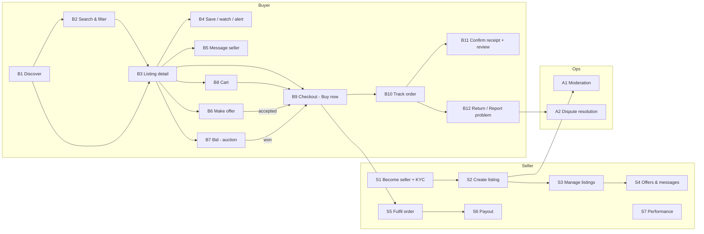
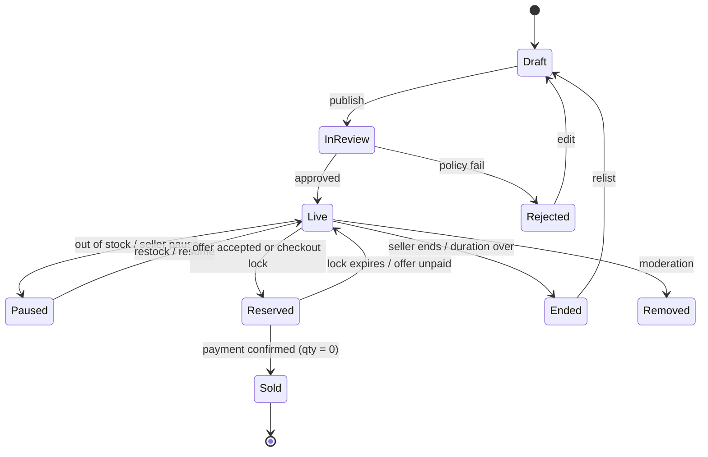
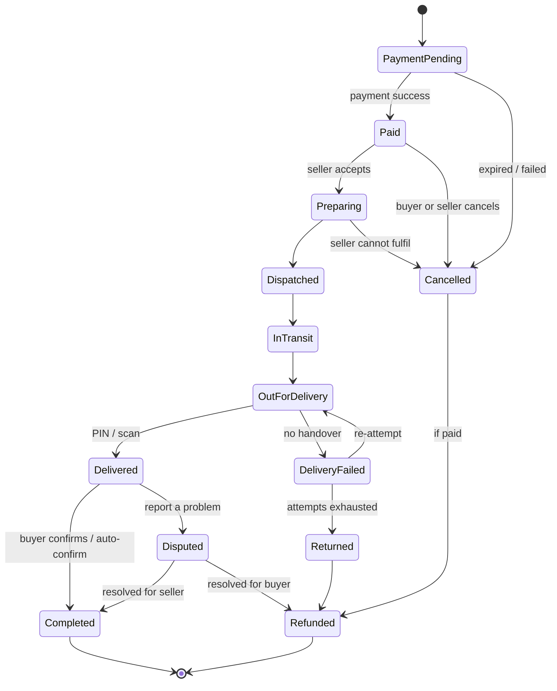
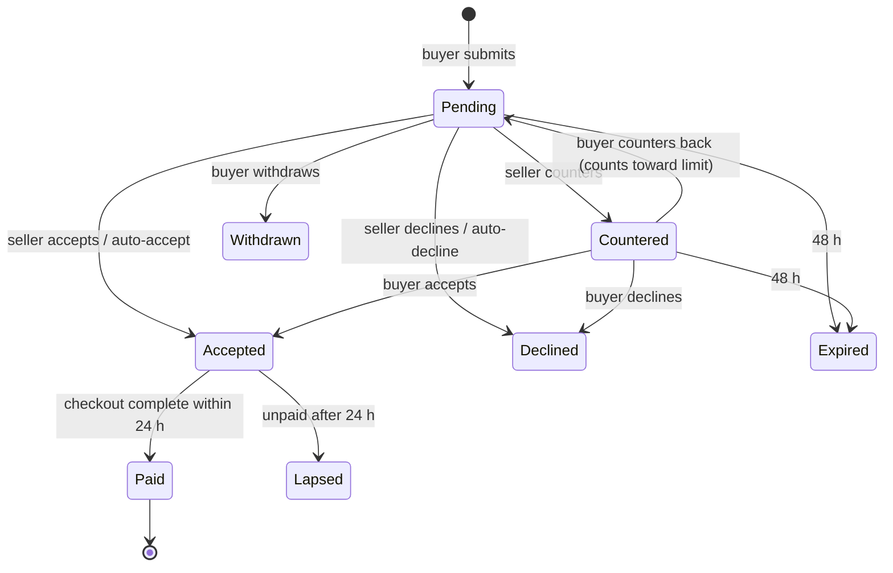
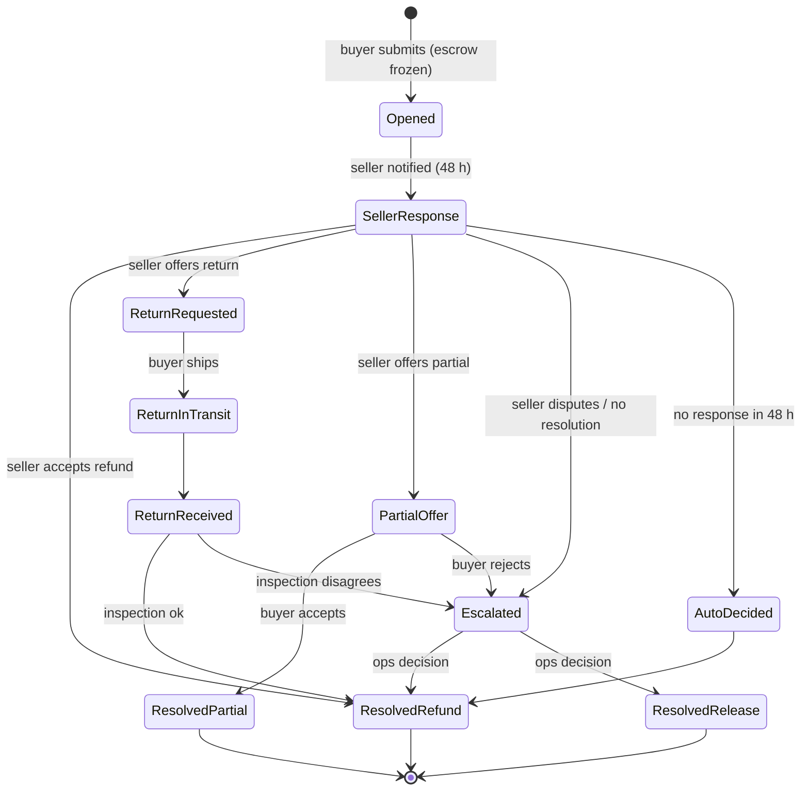
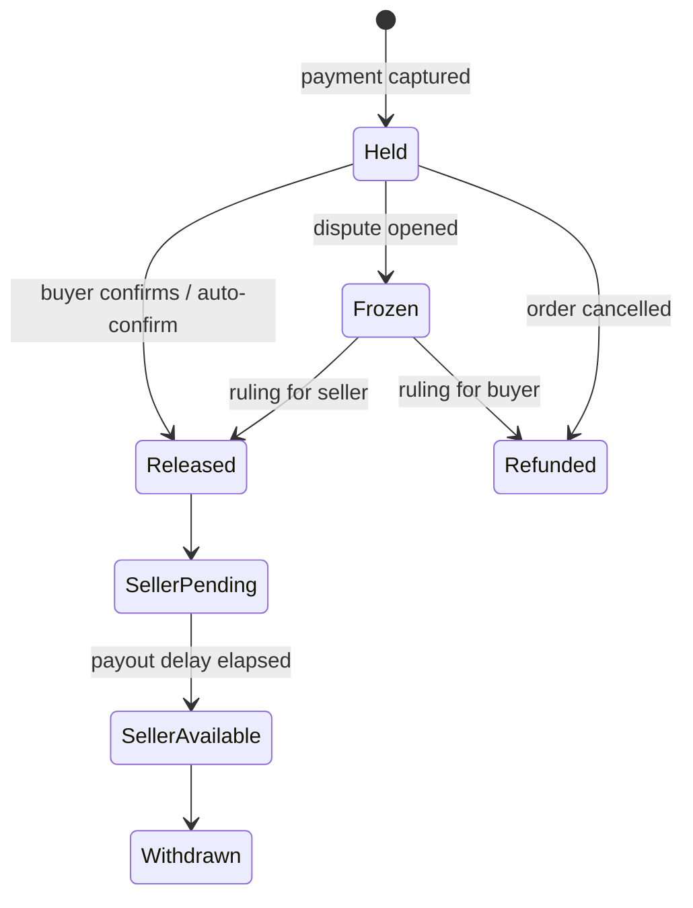
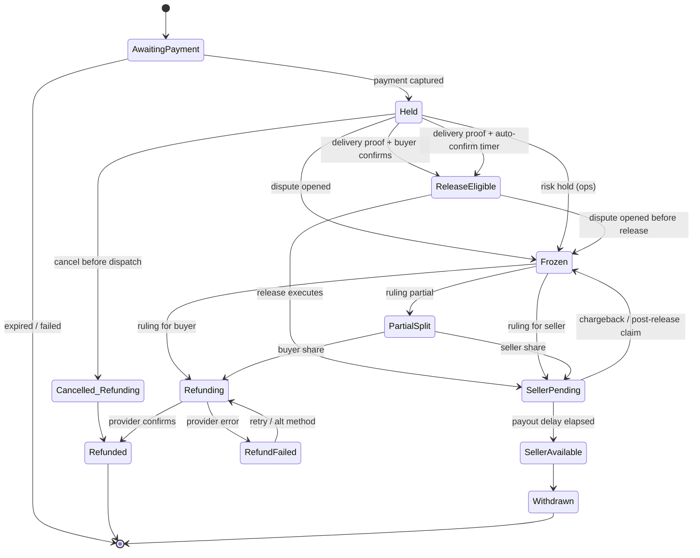

# WorldStreet Marketplace — End-to-End UX Flow Specification

Modelled on eBay's buyer, seller and trust flows, adapted for Nigeria (NGN, escrow, domestic delivery, local pickup).
Version 1.0 · 6 Oct 2026 · For: Greatness Omotomiye (design engineering)

Companion to `worldstreet-marketplace-ux-blueprint.md` (research + audit). This file is the **build spec**: every flow, screen, state, rule and edge case needed to make the marketplace work end to end.

---

## 0. How to read this document

**Provenance tags.** eBay behaviour that I saw live on ebay.com (6 Oct 2026) is tagged `[eBay-observed]`. eBay behaviour behind sign-in that I did not open is tagged `[eBay-inferred]`. Anything tagged `[WS]` is a WorldStreet decision (a deliberate change from eBay). Where a rule has a number (hours, days, limits), treat it as a **proposed default** to be confirmed by product, ops and legal. These numbers are not eBay's published figures.

**IDs.**
- Flows: `B` buyer, `S` seller, `A` admin/ops, `X` cross-cutting.
- Screens: `SCR-xxx`. Routes in `code`.
- Rules: `R-xxx`. Edge cases: `EC-xxx`. Events: `evt_snake_case`.

**Notation.** Each flow lists: Goal · Entry points · Preconditions · Main path · Alternates · Errors · States touched · Exit/Success · Events.

**What the sandbox already has** (from the live audit): home, category rail, location control, hero carousel, trust strip, listing cards, sort, category filter chips, heart-to-save with toast, mobile bottom nav, footer link map. Everything else in this document is **to build**. First four blockers: card links, working search, one canonical NGN price, honest location radius.

---

## 1. Actors, accounts and permissions

| Actor | Description | Can do without signing in | Needs sign-in | Needs extra verification |
|---|---|---|---|---|
| Guest | Anonymous visitor | Browse, search, view listings and seller pages, add to cart (local), read help | Save, message, offer, checkout, review | – |
| Buyer | Signed-in account (phone verified) | All guest actions + save, watch, message, offer, checkout, track, review, dispute | – | Card/bank link at first payment; KYC tier for high-value orders `[WS]` |
| Seller | Buyer + seller profile | All buyer actions + list, manage, fulfil, payouts | – | Phone + ID/KYC + payout account before first publish `[WS]` |
| Admin/Ops | Staff | Moderate, resolve disputes, hold/release escrow, ban | Always | Role-based access + audit log |
| System | Scheduled jobs | Auto-release escrow, expire offers, end listings, send reminders | – | – |

**Account levels `[WS]`** (drives limits, shown in profile):
- **L0 Guest** — no account.
- **L1 Verified phone** — OTP verified. Can save, message, buy up to the L1 cap.
- **L2 Verified identity** — ID/BVN/NIN matched. Higher buy cap, can sell.
- **L3 Trusted seller** — meets performance standards (see S7). Faster payouts, badge.

> Note on KYC: BVN/NIN verification touches regulated data. Confirm legal basis, consent wording and storage with counsel before building.

---

## 2. Global rules (apply to every flow)

**R-001 Location context.** On first visit, infer city from IP and show an inline bar (not a blocking modal) "Showing items near Lagos · Change". Store in `location` (city, lat/lng, radius). eBay blocks the page with a modal asking "Are you shipping to [postcode]?" `[eBay-observed]`; WorldStreet should not block.

**R-002 Currency.** Every price is stored and sorted as integer **kobo** in NGN (`price_minor`). Display always `₦` via `formatCurrency()`. If a seller wants to quote a foreign amount, show `≈ ₦X` as primary and the original as secondary. No mixed-currency lists. (Fixes audit F3/F4.)

**R-003 Total cost principle.** Any place a price is shown to a buyer (card, detail, cart) must be able to show **"Total to {city}"** = item + delivery + fees − discounts. eBay shows delivery only as small grey text and for Nigeria often exceeds the item price `[eBay-observed]`.

**R-004 Auth gating.** Guests can do read-only and cart actions. On any gated action (save, message, offer, checkout) show a bottom sheet / modal "Sign in to continue", preserve intent, and **resume the action after sign-in** (return to the same listing with the action completed or pre-filled).

**R-005 Money stays on platform.** All payments go through WorldStreet checkout into escrow. Off-platform payment voids protection (mirrors eBay's Money Back Guarantee condition `[eBay-observed]`). Messaging scans for phone numbers/bank details and shows a warning (R-051). Protection applies only to payments captured by WorldStreet checkout. **Full escrow design: Part L.**

**R-006 Time.** Store UTC; display Africa/Lagos (WAT). Countdowns use server time offset to prevent client clock drift.

**R-007 Empty/loading/error states.** Every list and page has: skeleton, empty (with next action), error (with retry + support link), and offline (cached content with banner).

**R-008 Idempotency.** All money-moving and state-changing endpoints accept an idempotency key (checkout confirm, offer accept, payout request, dispute submit) so double taps and retries never double-charge.

**R-009 Mobile first.** Primary CTAs reachable by thumb, sticky bottom action bar on listing detail, sheets instead of dropdowns on ≤ 768px, 44px touch targets.

**R-010 Accessibility.** WCAG 2.2 AA: text contrast ≥ 4.5:1, visible focus, keyboard parity, `aria-pressed` on toggles, live regions for toasts and bid/price updates, reduced-motion respected.

**R-011 URLs.** Every meaningful state is a URL: `/search?q=&cat=&min=&max=&cond=&fmt=&radius=&sort=`, `/listing/:id`, `/seller/:handle`, `/orders/:id`. Back button restores filters and scroll position.

**R-012 Notifications.** In-app bell + push + SMS (critical only) + email (receipts). Preferences per channel and category. Payment/dispute events cannot be fully muted.

---

## 3. Flow map (index)

---

# PART A — BUYER FLOWS

## B1. Discover (home, categories, deals, near you)

**Goal:** get a buyer from landing to a relevant listing in ≤ 2 interactions.
**Entry:** direct, shared link, push notification, search engine.
**Preconditions:** none (guest ok).

**Main path**
1. Land on `/`. Header: logo, location selector, scope selector (All categories ▾), search box, notifications, saved, Create listing, avatar. `[WS]` search is the most prominent control; on mobile the search icon expands to a full-width field (the sandbox currently relies on a bottom-nav Search icon).
2. Inline location bar confirms city (R-001).
3. Trust strip (Escrow · Trackable delivery · Wallet payout) stays visible above the fold.
4. Rails, in order: category rail → hero (max 3 slides, user-controlled) → shop by category (counts) → **Recently viewed** (returning users) → **Near you** → **Deals ending soon** → **Because you saved…** (returning users) → sell CTA → All listings.
5. Tapping any card goes to `/listing/:id` (B3). Tapping a category goes to `/search?cat=…` (B2) with the category pre-applied.

**Rules**
- R-013 A listing appears **once** per page; dedupe across rails (audit F14).
- R-014 Rails with < 4 items collapse; never show a rail with 0.
- R-015 Carousels have visible controls, pause button, and do not autoplay under reduced-motion (audit F8).
- R-016 Category counts equal the number of *visible* listings under the current location scope, or are labelled "nationwide" (audit F6).

**Alternates:** first-time visitor sees a one-line value prop and a "How escrow works" link. Returning buyer with an unfinished checkout sees a **resume banner**.
**Errors:** rail data fails → rail hides with a quiet retry link; page never blank.
**Events:** `evt_home_view`, `evt_rail_impression{rail}`, `evt_card_click{rail,listing_id,position}`, `evt_location_change`.

---

## B2. Search and filter

**Goal:** turn intent into a ranked, filterable result set.
**Entry:** header search, category tap, saved search, related-search chip, voice/camera (later).

**Main path**
1. Focus search → panel opens with **recent searches**, **trending**, **categories**.
2. Typing (≥ 2 chars, 150 ms debounce) → suggestions: query completions, category matches ("headphones in Electronics"), seller matches, listing title matches. Keyboard: ↑ ↓ Enter Esc.
3. Submit → `/search?q=…`.
4. Results page layout `[eBay-observed pattern]`:
   - **Desktop:** left rail (Category tree, Delivery options, filters with counts) · top bar (result count, Save this search, Buying format, Condition, Sort, grid/list toggle) · results.
   - **Mobile:** sticky "Filters · Sort" bar; filters in full-height bottom sheet with live count on the Apply button ("Show 124 results").
5. Active-filter chips appear above results; each removable; "Clear all".
6. Result cards contain (in order): image, title, condition badge, format badge, price, **Total to {city}**, seller name + rating, distance, social-proof (sold/watchers), save heart.
7. Pagination: infinite scroll with "Load more" fallback and preserved scroll on Back (R-011). Show position "Showing 48 of 1,284".

**Filters (v1)** — each with counts that update as others change:
- Category (tree), Price (min/max, histogram optional), Condition (New, Like new, Refurbished, Used, For parts), Buying format (Buy now, Accepts offers, Auction), Location radius (5/10/25 km, Nationwide), Delivery (Free delivery, Pickup available, Delivers in ≤ 2 days), Seller (Verified, Top rated), Brand/attributes (category-specific facets), "Listed within" (24 h, 7 d, 30 d).

**Sort:** Best match · Price + delivery: low→high · high→low · Newest · Nearest · Ending soonest (auctions) · Biggest discount. All sorts operate on canonical NGN (R-002).

**Ranking (best match) `[WS]` initial formula:** text relevance (0.40) + seller quality (0.20) + freshness (0.10) + price competitiveness for the category (0.10) + completeness of listing (0.10) + distance (0.10). Sponsored placements (later) are labelled "Sponsored" `[eBay-observed]` and capped at 1 in 5.

**Alternates**
- *Zero results:* show spelling correction ("Did you mean…"), widen-radius suggestion ("12 results within 25 km"), remove-filter suggestions with counts, popular categories, **Save this search & notify me**.
- *Too many results:* show "Narrow by" prompt with the top 3 facets.
- *Filtered by location:* never show items outside the radius unless "Nationwide" chosen (audit F6).

**Errors:** search timeout → keep last results, inline banner "Search is slow — retry"; suggestions failing → fall back to recent searches only.
**Events:** `evt_search_submit{q,filters}`, `evt_suggest_click{type}`, `evt_filter_apply{facet,value}`, `evt_sort_change`, `evt_zero_results{q}`, `evt_save_search`.

**Edge cases**
- EC-001 Query contains only stop words → treat as browse of all.
- EC-002 Query is a listing ID/URL → go straight to that listing.
- EC-003 Query in Pidgin/Yoruba/Hausa/Igbo → synonyms table (e.g., "fón", "laptop", "generator" variants) maintained by ops.
- EC-004 Prohibited term search (weapons, etc.) → neutral "No results" + policy link, no suggestions.

---

## B3. Listing detail

**Goal:** give a buyer everything needed to decide, in one screen, without leaving the page.
**Entry:** card click, deep link, notification, message thread, order page "Buy again".
**Route:** `/listing/:id-:slug`

**Layout (desktop two-column, mobile single column with sticky bottom bar)** `[eBay-observed order]`
1. **Gallery** — zoom, swipe, keyboard arrows, thumbnails, "n / total", video first if present. Badges: condition, discount %, urgency ("In 3 carts" only if true).
2. **Buy box**
   - Title · condition (with definition link) · category breadcrumb.
   - **Seller strip:** avatar, name, verified tick, rating + count, area, "Message", "Seller's other items".
   - **Price** (₦), was-price and % off if applicable, unit price if multi-quantity.
   - **Variations** (size/colour) as chips; out-of-stock combos disabled with reason.
   - **Quantity** stepper with "6 available · 1,350 sold" (real counts).
   - **Actions:** primary **Buy now**; secondary **Add to cart**; **Make offer** (if enabled); **Place bid** (auction); tertiary **Save / Watch**.
   - **Demand line:** "12 people are watching this" (real counts only).
   - **Reassurance:** "Returns accepted · 7 days" or "No returns — sold as described" and "Protected by WorldStreet escrow".
3. **Delivery & returns block** `[eBay-observed]`
   - Delivery method list for the buyer's location: *Rider delivery* (cost, ETA range), *Pickup station* (cost, ETA), *Meet-up / local pickup* (free, with safety tips).
   - **Delivery estimate as a date range to the buyer's address area** ("Thu 8 – Sat 10 Oct to Lekki").
   - Seller handling time ("Ships within 1 day after payment cleared").
   - Return policy: window, who pays return shipping, restocking.
   - **Total to {city}** line.
4. **Shop with confidence** — Escrow explained in one sentence + link; Verified seller; Report this listing.
5. **Item specifics** (structured attributes) and **seller notes**, **description** (sanitised rich text), listing ID, **"Last updated … View history"** `[eBay-observed]` to reduce bait-and-switch.
6. **Seller card** — joined date, response time, sold count, detailed ratings (Accurate description, Delivery speed, Communication, Packaging) `[eBay-observed]`, Visit shop, Save seller.
7. **Reviews/feedback** — tabs "This item / All items from seller"; topic chips; each review: masked buyer name, verified purchase tag, date bucket, text, seller reply.
8. **Similar items**, **Seller's other items**, **Recently viewed**.
9. **Safety tips** (meet in public places, inspect before confirming, never pay outside WorldStreet).

**Sticky bottom bar (mobile):** price + primary CTA ("Buy now") + heart + overflow (Share, Report).

**Rules**
- R-020 Show the same total (₦) in the buy box, the sticky bar and the cart.
- R-021 If a listing is unavailable (sold out, ended, removed), keep the page for SEO and sharing but replace CTAs with "No longer available" and show similar items.
- R-022 "Buy now" with a missing required variation scrolls to the selector, highlights it, and announces the error (don't disable the button silently).
- R-023 Images use responsive `srcset`, blurred placeholder, fixed aspect ratio to avoid layout shift.
- R-024 Price changes while the page is open → inline notice "Price updated to ₦X" before any checkout.

**Alternates:** pickup-only listing (hide delivery cost, show map pin of approximate area, not exact address); service listings (no delivery block, "Request booking"); property/vehicle (no escrow checkout; "Contact seller" and "Book viewing" with inspection safety messaging) `[WS]`.

**Errors:** listing deleted → 410 page with search suggestions; gallery image fails → grey placeholder with retry.
**Events:** `evt_listing_view{id,source}`, `evt_gallery_interact`, `evt_buy_now_click`, `evt_add_to_cart`, `evt_offer_open`, `evt_message_open`, `evt_share`, `evt_report_listing`.

---

## B4. Save, watch and alert

**Goal:** let buyers come back to things and be told when they change.

**Main path**
1. Heart on card or detail → if guest, auth sheet then resume (R-004).
2. Toggle on → `aria-pressed=true`, toast "Added to Saved · View" (sandbox already has toast; add state exposure — audit F9).
3. Saved lists at `/saved` with tabs: Listings · Sellers · Searches. Items show current price and a **"Price dropped ₦X"** or **"Ending in 2h"** tag.
4. Alerts (opt-in per item or saved search): price drop, back in stock, ending soon (auction), new matching listing. Delivered via push/email per R-012.

**Rules**
- R-025 Watching increments a real "watchers" count (private to seller unless > 10 and enabled).
- R-026 Saved items from sold/ended listings stay for 30 days, marked "Sold".
- R-027 Maximum 500 saved listings, 50 saved searches.

**Edge cases:** EC-005 saving the same item from two devices → idempotent. EC-006 seller removes listing → saved entry shows "Removed" with similar items.
**Events:** `evt_save_toggle{type,id,on}`, `evt_alert_create`, `evt_alert_fire`.

---

## B5. Message seller (pre- and post-purchase)

**Goal:** answer questions safely, keep the conversation tied to the listing and the order.

**Main path**
1. "Message" on listing → if guest, auth then resume.
2. `ContactSellerModal` / sheet: suggested quick questions ("Is this still available?", "Can you deliver to Ikeja?", "More photos?"), free text (max 1,000 chars), attach up to 3 photos.
3. Send → thread created at `/inbox/:threadId` with a pinned **listing card** at top. Seller notified (push + in-app).
4. Thread view: bubbles (`MessageBubble`), delivery state (sent, delivered, read), typing indicator (optional), timestamps, "Seller usually replies within 2 hours".
5. Offers made in-thread appear as **offer cards** with Accept/Counter/Decline (see B6).

**Safety rules**
- R-050 First message to a seller shows a banner: "Keep payment and chat on WorldStreet. We can only protect payments made here."
- R-051 Detect phone numbers, account numbers, external links, "pay me directly" patterns → inline warning on send; repeated attempts → flag for review.
- R-052 Blocking and reporting available on every thread; blocked users cannot message again.
- R-053 Rate limits: 20 new conversations/day per L1 buyer.

**Alternates:** seller unresponsive 48 h → prompt buyer "Find similar items". Thread auto-links to order after purchase (single timeline).
**Errors:** upload fails → message saved as draft; retry per attachment.
**Events:** `evt_msg_send`, `evt_msg_read`, `evt_msg_flagged`, `evt_block_user`.

---

## B6. Make an offer (Best Offer) — buyer side

`[eBay-observed]` that "or Best Offer" appears on listings; mechanics `[eBay-inferred]`.

**Goal:** negotiate within rules, without endless chat.

**Preconditions:** listing has offers enabled; buyer L1+; buyer has no open offer on this listing.

**Main path**
1. Tap **Make offer** → `OfferModal`: shows list price, seller's auto-decline floor is **not** shown; input for offer (₦), quantity, optional note; helper text "Offer valid for 48 hours" and "You have 3 offers left on this item".
2. Validate: ≥ 50% of list price (configurable per seller/category), ≤ list price, numeric, whole naira.
3. **Authorise payment method** (card/bank hold optional `[WS]`): binding offer — if accepted, the buyer is committed to pay within 24 h. Show this clearly: "If the seller accepts, you'll be asked to pay within 24 hours."
4. Submit → confirmation sheet + entry under `/offers`. Seller notified.
5. Outcomes:
   - **Accepted** → push + "Pay now" CTA → checkout (B9) pre-filled with offer price; listing is reserved for the buyer for 24 h.
   - **Countered** → buyer sees counter with Accept / Counter back / Decline.
   - **Declined** → reason optional; buyer may make a new offer if offers remain.
   - **Expired** (48 h) → auto-closed, buyer notified; the expired offer still counts toward the 3-offer limit `[WS]`.

**Offer state machine** — see §6.3.

**Rules**
- R-030 Max 3 offers per buyer per listing; max 5 open offers per buyer account.
- R-031 One active offer thread per buyer per listing.
- R-032 When an offer is accepted, quantity is reserved; other buyers see "Offer pending".
- R-033 A seller can send an **unsolicited offer** to watchers (later phase).
- R-034 Accepted offers that go unpaid for 24 h cancel automatically and count against the buyer's reliability score.

**Events:** `evt_offer_submit{amount_pct}`, `evt_offer_accept`, `evt_offer_counter`, `evt_offer_decline`, `evt_offer_expire`.

---

## B7. Auction and bidding (phase 8, optional)

`[eBay-inferred]`.

**Main path:** Place bid → enter max bid → proxy bidding raises minimally to stay highest → outbid push → ending-soon alerts → auction ends → winner redirected to checkout with a 24-hour pay window.

**Rules:** minimum increment table by price band; last-minute extension (anti-sniping) of 2 minutes if a bid lands in the last 2 minutes `[WS]`; reserve price hidden; bid retraction only under defined conditions; non-paying winners get strikes.
**Components:** `BidPanel`, `CountdownTimer` (server-synced), `BidHistory`.
**Events:** `evt_bid_place`, `evt_outbid`, `evt_auction_end`, `evt_auction_win`.

---

## B8. Cart

`[eBay-inferred]` — grouped by seller.

**Goal:** collect items from one or several sellers and pay once.

**Main path**
1. Add to cart (from card quick-add, detail, or saved). Toast + **mini-cart drawer**: item, qty, subtotal, "View cart", "Checkout".
2. Cart page `/cart`:
   - Grouped **by seller**; each group has its own delivery method and delivery subtotal.
   - Line items: image, title, variation, qty stepper (max = available), price, remove, **Save for later**.
   - Coupon field (one per order).
   - Summary: items, delivery, discounts, **Total**, "Checkout" (sticky on mobile).
3. Guest cart persists locally; merges into account cart on sign-in.

**Rules**
- R-035 Cart reservations: **no** inventory lock in cart. Stock is re-verified at checkout start; a lock of 10 minutes begins when the buyer reaches payment.
- R-036 Mixed delivery types (pickup + rider) are allowed per seller group.
- R-037 A listing that becomes unavailable shows inline "No longer available — Remove / See similar" and blocks Checkout until resolved.
- R-038 Price/stock drift since add: banner "2 items changed since you added them" with diff.
- R-039 Maximum 50 items, 10 sellers per cart.

**Events:** `evt_cart_add`, `evt_cart_qty_change`, `evt_cart_remove`, `evt_coupon_apply{ok}`, `evt_checkout_start`.

---

## B9. Checkout and payment

**Goal:** one clear page, all costs visible, one confirm.

**Entry:** Buy now, cart checkout, accepted offer, auction win.
**Preconditions:** signed in L1+; phone verified; items available.

**Layout:** single page with three stacked, editable sections + sticky order summary (desktop right column; mobile collapsible at top and repeated above the pay button).

**Step 1 — Ship to**
- Saved addresses (radio) or **Add address**: Name, phone (+234), State, City/Area, Street, **Landmark** (required), Delivery notes, geo-pin optional. Address autocomplete; validate state/LGA against list.
- For pickup-only items: show seller area and pickup rules; no address needed.

**Step 2 — Delivery** (per seller group)
- Options with cost and date range: Rider delivery · Pickup station · Meet-up. Default to the cheapest option that meets the seller's handling time.
- Show seller handling time and the **estimated delivery window**.

**Step 3 — Pay**
- Methods: Card, Bank transfer (dynamic account number with countdown), USSD, WorldStreet wallet balance, (later) Pay on delivery for L2+ and low value only `[WS]`.
- **Total** with line items; coupons; fees (if any buyer fee) clearly named.
- Escrow notice: "Your money is held until you confirm delivery. Learn more".
- Terms link; **single confirm button** that names the amount: "Pay ₦84,500".

**Main path**
1. Review → Pay → payment provider step (3-D Secure / bank app / USSD prompt) → return to WorldStreet.
2. On success → order(s) created per seller; escrow funds held; **confirmation page** `/orders/:id/confirmation`: order number, items, ETA, delivery address, "What happens next" (4 steps), "Message seller", "Track order".
3. Emails/SMS/push receipts sent.

**Payment failure paths**
- *Declined / insufficient funds:* stay on page, keep input, show reason and alternative methods; do not clear cart.
- *Timeout / unknown status:* show "Checking your payment…" with polling up to 60 s; if unknown, order created in `payment_pending`, buyer told "We'll confirm by SMS within 10 minutes. Don't pay again."
- *Bank transfer window expired (e.g., 30 min):* order cancelled, cart restored.
- *Double submit:* idempotency key prevents duplicates (R-008).

**Rules**
- R-040 Re-price and re-stock check on entering step 3; if changed, block and explain.
- R-041 Inventory lock: 10 minutes from entering step 3; countdown shown; release on expiry.
- R-042 Inline validation per field, error summary at top for screen readers, focus moves to first error, user input preserved.
- R-043 All costs shown **before** the pay button; no costs added after.
- R-044 Orders for items above the L1 cap require L2 verification before payment (flow B9-KYC: inline sheet, return to checkout).
- R-045 Multi-seller checkout creates one payment and N orders; refunds are per order.

**Events:** `evt_checkout_view`, `evt_address_add`, `evt_delivery_select`, `evt_pay_submit{method}`, `evt_pay_success`, `evt_pay_fail{reason}`, `evt_order_created`.

**Edge cases:** EC-007 buyer closes app mid-payment → resume banner on next open. EC-008 same item bought by two buyers simultaneously → second gets "Just sold" at lock step. EC-009 address outside seller's delivery zone → disable rider option, offer pickup or message seller.

---

## B10. Order tracking and delivery

**Goal:** make the status of money and goods unambiguous at all times.

**Route:** `/orders` (list) and `/orders/:id` (detail).

**Order list:** tabs Active · Completed · Cancelled · Returns. Each row: thumbnail, title, status chip, ETA, primary action (Track / Confirm receipt / Review / Buy again).

**Order detail:**
- **Status timeline** (`OrderStatusTimeline`): Paid → Seller preparing → Dispatched → In transit → Out for delivery → Delivered → Confirmed → Funds released.
- Delivery card: courier/rider name, **rider phone** (masked relay number), tracking events, map (later), ETA, **delivery PIN/QR** shown to the rider at handover `[WS]`.
- Escrow card: "₦84,500 held · releases when you confirm or in 3 days after delivery".
- Actions per state: Message seller · Cancel (before dispatch) · Report a problem · Return · Confirm receipt.
- Receipt download (PDF).

**Rules**
- R-060 **Buyer cancel:** allowed before `dispatched`; automatic refund to original method/wallet within the provider's window; seller notified.
- R-061 **Seller must dispatch** within the handling time (default 2 days). Missed → buyer notified with options "Wait" or "Cancel & refund"; seller penalised.
- R-062 **Confirm receipt:** *superseded by Part L (L4).* Buyer taps Confirm → release; otherwise auto-confirm after the category inspection window (24–72 h; none for vehicles/property), buyer may extend once by 24 h.
- R-063 Delivery proof: PIN/QR scan or photo by rider is the `delivered` trigger; without proof, status stays `out_for_delivery` and support is prompted after 48 h.
- R-064 If delivery fails (no one home): 2 re-attempts, then item returns to the seller; refund or reship per buyer choice.

**Events:** `evt_order_status{from,to}`, `evt_track_view`, `evt_cancel_request`, `evt_confirm_receipt`.

---

## B11. Review and feedback

`[eBay-observed]` feedback lists with "Verified purchase", masked IDs, time buckets, topic chips and detailed seller ratings (4 dimensions).

**Main path:** after Confirmed (or auto-confirm), prompt appears on the order, push at +24 h and +5 days. Screen: overall (1–5 stars), four dimension stars (Accurate description, Delivery speed, Communication, Packaging), optional text (≥ 20 chars suggested), optional photos. Submit → posted immediately; seller may reply once.

**Rules**
- R-070 Only buyers with a completed order can review; one review per order item.
- R-071 Editable for 7 days; seller reply cannot be edited after 7 days.
- R-072 Reviews that mention contact details or abuse are held for moderation.
- R-073 **Separate** the item review from the seller score on cards and detail: "This item ★4.9 (12)" vs "Seller ★4.8 (1,203)" (audit F13).
- R-074 Retaliatory feedback is not possible; sellers cannot leave negative feedback for buyers (they use a private "report buyer" instead).

**Events:** `evt_review_submit`, `evt_review_reply`, `evt_review_flag`.

---

## B12. Return, refund and "Report a problem" (buyer protection)

Mirrors eBay Money Back Guarantee: covers **item not received**, **item not as described / damaged**, and **seller not honouring stated return policy** `[eBay-observed]`. Protection applies only to payments made on-platform `[eBay-observed]`.

**Entry:** order detail → "Report a problem" (available from `delivered` until the escrow release, and up to 14 days after for "not as described" `[WS]`).

**Wizard (4 steps)**
1. **What happened?** Not received · Wrong item · Damaged or faulty · Not as described · Missing parts · Other.
2. **Evidence:** photos/video (required for damage/not as described), description, whether the buyer opened the package.
3. **What do you want?** Full refund · Partial refund · Replacement · Return for refund. Show eligibility and who pays return shipping per listing policy (default: seller pays for faulty/not-as-described).
4. **Review & submit** → case created; **escrow release is frozen** immediately.

**Seller response window:** 48 h to Accept / Offer partial / Propose return / Dispute.
- *Accept* → refund executed from escrow; case closed.
- *Offer partial* → buyer accepts or escalates.
- *Return* → return label/instructions generated; buyer ships within 5 days; seller inspects within 3 days of receipt; refund on receipt scan.
- *No response* → auto-decided for buyer after 48 h if evidence is plausible `[WS]`, else sent to ops.
- *Dispute* → escalates to **Ops review** (A2) with a 3-business-day SLA.

**Dispute state machine** — see §6.4.

**Rules**
- R-080 Non-receipt cases open only after the delivery window + 2 days has passed.
- R-081 Buyer can escalate any time after seller response or after the seller's window lapses.
- R-082 Ops decision is final within the platform; appeal once within 7 days with new evidence.
- R-083 Refund destinations: original payment method or wallet (buyer's choice where provider allows).
- R-084 Excluded items (services, property, vehicles, digital goods) follow separate rules and are marked on the listing `[eBay-observed exclusions]`.
- R-085 Abuse controls: repeated unfounded claims lower the buyer's trust level; repeated valid claims suspend the seller.

**Events:** `evt_dispute_open{reason}`, `evt_dispute_seller_response`, `evt_dispute_escalate`, `evt_dispute_resolve{outcome}`, `evt_refund_issued`.

---

# PART B — SELLER FLOWS

eBay's selling flow, from the public Selling page `[eBay-observed]`: AI-assisted listing, "only pay a final value fee when it sells", titles with brand/model/size/colour, multi-angle photos, choose Buy It Now vs Auction, price from recent sales, promoted listings, discounted shipping labels, local pickup. The wizard steps and Seller Hub tabs below are `[eBay-inferred]`.

## S1. Become a seller and verify (onboarding + KYC)

**Goal:** get a trustworthy seller to first publish in under 10 minutes without weakening safety.
**Entry:** "Start selling", "Create listing" (when not yet a seller), footer "Seller tools", promo banners.

**Main path**
1. **Intro** `/sell/start`: value points (free listing, escrow, wallet payout), fee table link, "Takes about 5 minutes".
2. **Profile:** shop name, handle (unique), avatar, short bio, area (city + neighbourhood), categories sold.
3. **Phone & email OTP** (if not already L1).
4. **Identity (L2):** ID type + number, selfie liveness, name match with payout account name. Show progress and why each item is needed. Allow **"Save and continue later"**.
5. **Payout account:** bank + account number → name enquiry resolves account name; confirm. Or WorldStreet wallet only.
6. **Seller agreement + policy quiz** (3 questions: prohibited items, off-platform payments, return obligations).
7. **Done** → Seller Hub with a first-task checklist: "Create your first listing".

**Rules**
- R-100 A user can **draft** listings before KYC completes but cannot **publish** until L2 + payout account are set. Drafts survive.
- R-101 KYC statuses: `not_started → in_review → approved | rejected | needs_more_info`. `in_review` target < 1 hour for automated checks, < 24 h manual.
- R-102 Rejection shows the reason in plain language and a fix path; max 3 attempts per 24 h.
- R-103 Business sellers (CAC number) can add a business profile and invoice details (later).

**Errors:** name mismatch → "Account name must match your ID name" with edit option; selfie fails → tips (light, no glasses) and retry.
**Events:** `evt_seller_start`, `evt_kyc_submit`, `evt_kyc_result{status}`, `evt_payout_account_add`.

---

## S2. Create a listing (CreateListingWizard)

**Goal:** a complete, compliant listing in under 4 minutes (matches the sandbox's "first listing live in under four minutes" promise).
**Route:** `/sell/new` (also `/sell/:draftId`). **Autosave** after every field blur and every 10 s; draft listed under Seller Hub → Drafts.

**Step 1 — Photos & video**
- Drag/drop or camera; up to 12 photos + 1 video (30 s). Reorder by drag; first = cover; crop/rotate; **auto-compress** to ≤ 300 KB web versions; progress per file; failed upload retry.
- Photo guidance: "Add front, back, any damage". Minimum 1 photo; recommended 4+.
- **AI assist (optional):** from the photos suggest title, category and attributes; the seller confirms every field (never auto-publish).

**Step 2 — Category & details**
- Category picker with search ("Find a category"), suggestions from photo/title.
- **Item specifics** form generated from the category (Brand, Model, Size, Colour, Storage…). Required ones marked; dropdowns with "Other". Barcode/IMEI field for phones (anti-stolen-goods check).
- **Condition** (New, Like new, Refurbished, Used, For parts) with definitions. Notes on flaws (required if Used/For parts).

**Step 3 — Title & description**
- Title (≤ 80 chars) with live counter and tips ("Brand + model + key feature, no ALL CAPS") `[eBay-observed tips]`; duplicate detector.
- Description (rich text, ≤ 5,000 chars). Prompt checklist: what's included, flaws, reason for selling.

**Step 4 — Format & price**
- Format: **Buy now** (default), **Accept offers** (toggle; set auto-accept ≥ ₦X, auto-decline < ₦Y), **Auction** (phase 8: start price, reserve, duration 1/3/5/7/10 days).
- Price (₦, integers), quantity, SKU (optional), variations (size/colour with per-variant stock).
- **Price guidance panel:** "Similar items sold for ₦X–₦Y (median ₦Z)" from recent sales; slider position indicator; warn if > 30% above median or < 40% below.
- Optional "Strike-through price" requires a price history of ≥ 7 days at the higher price (anti-fake-discount rule `[WS]`).

**Step 5 — Delivery**
- Methods: Rider delivery · Pickup station · Meet-up/local pickup · Nationwide courier. For each: coverage zones (cities/areas), fee model (flat / weight-based / buyer pays at checkout), handling time (same day, 1, 2, 3 days).
- Package weight and size (small/medium/large presets).
- Free delivery toggle (absorbed into price display).

**Step 6 — Returns**
- Policy: No returns (as described) · 3 days · 7 days · 14 days; who pays return shipping; condition required. Note: legal protection for not-as-described remains regardless.

**Step 7 — Review & publish**
- **Live preview** as a buyer would see the card and the detail page (mobile/desktop toggle).
- **Fee preview:** "Listing fee ₦0 · Final value fee 5% (₦X) · Payment fee 1.5% · You'll receive ₦Y if sold at ₦Z".
- Optional **Promote** toggle (later).
- Checklist of blocking issues (missing photo, banned term, price 0) and warnings.
- **Publish** → moderation pre-check (automated, < 10 s) → *Live*, or *In review* if flagged.
- Success screen: share link, "Copy for WhatsApp", "Create another", "View listing".

**Rules**
- R-110 Prohibited/restricted list enforced at title/description/category/photo (hash + ML) level; show specific policy link when blocked.
- R-111 Phones/laptops require serial/IMEI; luxury items may require proof or authenticity review `[WS]`.
- R-112 Edits to a live listing: price/quantity/description allowed anytime and logged to "revision history"; **cannot** change category or condition after first sale without relist.
- R-113 Duplicate listings by the same seller within 24 h are blocked or merged.
- R-114 Images: min 600px, max 10 MB original; EXIF stripped; face blurring not required.
- R-115 Listing duration: Buy now = **30 days, auto-renew** until sold or ended; auction durations as chosen.
- R-116 Required step errors are shown on the stepper (red dot) and on the final review; never lose data on validation failure.

**Edge cases:** EC-010 network drops mid-upload → resume on reconnect. EC-011 seller leaves and returns → draft restores at last step. EC-012 listing in review > 24 h → notify seller and escalate.
**Events:** `evt_list_start`, `evt_list_step{n}`, `evt_list_ai_accept`, `evt_list_price_warn`, `evt_list_publish`, `evt_list_blocked{reason}`.

---

## S3. Manage listings (ListingsManagementTable)

**Route:** `/vendor/listings` (the sandbox links to `/vendor`).
**Views:** table (desktop) / cards (mobile). **Tabs:** Active · Drafts · Scheduled · Ended/Sold · In review · Removed.
**Columns:** photo, title, price, qty, views (7 d), watchers, offers, status, last updated, actions.
**Bulk actions:** edit price (set / % change), edit quantity, end listing, relist, add promotion, change delivery profile, export CSV.
**Row actions:** edit, duplicate ("sell similar"), end, relist, promote, share, view.
**Inline edit:** price and quantity directly in the row with undo toast.
**Filters:** status, category, stock, "needs attention" (low stock, no views in 14 days, price above market, removed).
**Insights nudges:** "No views in 14 days — improve photos or lower price", "3 watchers — send them an offer" (later).

**Rules:** R-120 Ending a listing with open offers/pending orders requires confirmation and auto-declines offers. R-121 Out-of-stock listings auto-pause; restock reactivates. R-122 Import (CSV) validated row by row with an error report (phase 7).

**Events:** `evt_listing_edit`, `evt_listing_end`, `evt_bulk_action`.

---

## S4. Handle offers and messages (seller)

**Offers inbox** `/vendor/offers`: list sorted by expiry; each row shows buyer trust badge, offer ₦ and % of list, expiry countdown, quantity, note.
**Actions:** Accept · Counter (must be between offer and list price) · Decline (optional reason). Auto-accept/decline thresholds from S2 resolve automatically and are labelled "Auto".
**Messages** `/inbox`: unified inbox for buyer and seller roles with filters (Unread, Offers, Orders, Archived), quick replies, saved snippets, away mode ("Back on Monday").

**Rules:** R-130 Offers expire at 48 h; seller gets reminders at 24 h and 4 h. R-131 Responding fast raises the seller's response-time stat. R-132 Accepting an offer reserves stock and starts the buyer's 24 h pay window; seller sees the countdown.

**Events:** `evt_offer_seller_action`, `evt_quick_reply_use`.

---

## S5. Fulfil an order

**Entry:** push "New order", Seller Hub → Orders → **To ship**.

**Order detail (seller):** items, buyer area, delivery method, handling deadline, **funds held in escrow**, buyer note.

**Main path**
1. **Accept/confirm** (auto for stock items; manual if the seller toggled "confirm each order") — within 12 h.
2. **Prepare:** packing checklist; print packing slip.
3. **Dispatch:** choose method.
   - *Platform rider/courier:* generate label with pickup slot or drop-off point; rider assigned; tracking auto-updates.
   - *Own delivery:* enter rider name/phone + ETA; buyer sees them.
   - *Meet-up:* agree time/place in thread; buyer scans **handover QR/PIN** to confirm.
4. Mark **Dispatched** → buyer notified, timeline advances.
5. **Delivered** (by rider scan/PIN) → buyer prompted to confirm.
6. After buyer confirms (or auto-confirm), funds move from escrow → seller available balance (S6).

**Seller exceptions:** out of stock after sale → **Cancel order** (reason required; counts as a seller-fault cancellation); buyer unreachable → "Contact buyer", then request cancel; item damaged in transit → open case with courier.
**Rules:** R-140 Handling-time breach auto-notifies buyer and records a late-shipment defect. R-141 Tracking is required for orders > ₦20,000 `[WS]`. R-142 Sellers cannot request buyers to cancel for price changes.

**Events:** `evt_order_confirm`, `evt_dispatch{method}`, `evt_order_cancel_seller`.

---

## S6. Payouts and wallet

**Money model:** buyer pays → **escrow ledger (held)** → on confirmation → **seller pending balance** → after payout delay → **available balance** → withdraw to bank.

**Seller Hub → Payments:** Available, Pending, In escrow, Held (disputes), recent transactions (`Transaction Table`), fee breakdown per order, **Withdraw** (to saved account; min ₦1,000; fee shown), export statements.

**Rules**
- R-150 *Superseded by Part L (L4).* Payout delay is risk-tiered: new sellers 48 h + 10% reserve for 14 days; L2 24 h; L3 instant.
- R-151 *Superseded by Part L (L7, L8).* Dispute freezes only affected line items; post-release claims recover from seller balance, then the Buyer Protection Fund.
- R-152 Fees deducted at release; invoice per order; VAT where applicable (confirm with finance/legal).
- R-153 Withdrawals processed within provider SLAs; failed payouts return to available with reason.
- R-154 Tie into the existing Wallet & Banking module (Multi-Balance Summary, Transaction Table, KYC-gated actions) — do not rebuild.

**Events:** `evt_payout_release`, `evt_withdraw_request`, `evt_withdraw_fail`.

---

## S7. Seller performance and standards

eBay surfaces seller standards and ratings (Top Rated Plus is shown on listings `[eBay-observed]`).

**Dashboard** `/vendor/performance`: Overall level (New · Standard · Trusted · Top rated · Below standard), metrics with 90-day window:
- Late dispatch rate (target < 5%) · Seller-fault cancellation rate (< 2%) · Not-as-described rate (< 3%) · Dispute rate (< 3%) · Average response time (< 4 h) · Average rating (≥ 4.5).
Each metric: current, target, trend, **what to do** link.

**Consequences:** Top rated → badge on cards, better ranking, faster payouts. Below standard → warning, ranking penalty, payout delay; repeated → listing restrictions → suspension (with appeal).

**Rules:** R-160 New sellers have a protection window (first 10 orders) with softer penalties but also a lower reserve. R-161 Everything penalising a seller must be explained, evidenced and appealable.

---

# PART C — ADMIN & OPS FLOWS

## A1. Listing moderation
Queue of auto-flagged and user-reported listings; actions: Approve, Request edit, Remove (with policy code), Suspend seller. SLA: high-risk 1 h, normal 24 h. Evidence panel shows images, history, seller profile, prior flags. All actions audit-logged. Notify seller with reason and appeal link.

## A2. Dispute resolution
Case view: timeline, messages, photos, order and payment data, delivery proof, seller/buyer history, policy hints. Decisions: Refund full/partial · Release to seller · Split · Request more info. Each decision sends both parties a written rationale. Appeals go to a second reviewer.

## A3. Risk and fraud
Signals: new account + high value, mismatched address/phone, repeated cancellations, many accounts per device, off-platform payment attempts, chargebacks. Actions: hold payout, step-up verification, cap limits, ban.

## A4. Support console
Search by order/user/listing; impersonate-view (read-only, logged); templates; link to case; escalate.

---

# PART D — NOTIFICATIONS MATRIX

| Event | Buyer | Seller | Channels | Notes |
|---|---|---|---|---|
| Order paid | ✔ receipt | ✔ new order | push, email, in-app | SMS for seller if > ₦50k |
| Order dispatched | ✔ | – | push, in-app, SMS | includes rider number |
| Out for delivery | ✔ | – | push, SMS | include PIN reminder |
| Delivered | ✔ confirm prompt | ✔ | push, in-app | |
| Auto-confirm warning (T−24 h) | ✔ | – | push | |
| Funds released | – | ✔ | push, email | |
| New message | ✔ | ✔ | push, in-app | batched if many |
| Offer received/response | ✔ | ✔ | push, in-app | expiry reminders |
| Price drop on saved | ✔ | – | push, email | opt-in |
| Dispute opened/updated | ✔ | ✔ | push, SMS, email | cannot be muted |
| KYC result | – | ✔ | push, email | |
| Listing removed/approved | – | ✔ | push, email | with reason |

Rules: quiet hours 22:00–07:00 for non-critical; digest option; unread badge counts must match the bell panel contents (the sandbox shows "12" with no panel).

---

# PART E — STATE MACHINES

## 6.1 Listing

## 6.2 Order

## 6.3 Offer

## 6.4 Dispute (Report a problem)

## 6.5 Escrow ledger (superseded by Part L, §L3 — kept for reference)

## 6.6 Timers (all defaults, configurable)

| Timer | Default | Trigger → outcome |
|---|---|---|
| Checkout inventory lock | 10 min | enter payment → lock released |
| Bank-transfer window | 30 min | no transfer → order cancelled |
| Offer validity | 48 h | no response → Expired |
| Accepted-offer pay window | 24 h | unpaid → Lapsed, listing unreserved |
| Seller order confirm | 12 h | no confirm → auto-confirm or cancel |
| Seller handling time | listing-defined (default 2 d) | missed → late-dispatch defect |
| Auto-confirm after delivery | 24–72 h by category (Part L, L4) | → Completed, escrow released |
| Seller dispute response | 48 h | → AutoDecided |
| Return ship window | 5 d | missed → case closed for seller |
| Inspection | 3 d after receipt | → refund |
| Ops dispute SLA | 3 business days | → decision |
| Review editing | 7 d | after → locked |
| Saved item retention after sold | 30 d | → removed |

---

# PART F — SCREEN & ROUTE INVENTORY

| ID | Screen | Route | Flow | Existing in sandbox? |
|---|---|---|---|---|
| SCR-001 | Home | `/` | B1 | Yes |
| SCR-002 | Categories index | `/categories` | B1 | Link exists, no screen |
| SCR-003 | Search results | `/search` | B2 | No |
| SCR-004 | Listing detail | `/listing/:id` | B3 | No |
| SCR-005 | Seller profile / shop | `/seller/:handle` | B3 | No |
| SCR-006 | Saved (listings/sellers/searches) | `/saved` | B4 | Toast only |
| SCR-007 | Inbox + thread | `/inbox`, `/inbox/:id` | B5/S4 | Tab only |
| SCR-008 | Offers (buyer) | `/offers` | B6 | No |
| SCR-009 | Cart | `/cart` | B8 | No |
| SCR-010 | Checkout | `/checkout` | B9 | No |
| SCR-011 | Order confirmation | `/orders/:id/confirmation` | B9 | No |
| SCR-012 | Orders list | `/orders` | B10 | No |
| SCR-013 | Order detail + tracking | `/orders/:id` | B10 | No |
| SCR-014 | Write review | `/orders/:id/review` | B11 | No |
| SCR-015 | Report a problem | `/orders/:id/problem` | B12 | No |
| SCR-016 | Return label/instructions | `/orders/:id/return` | B12 | No |
| SCR-017 | Notifications | `/notifications` | X | Bell only |
| SCR-018 | Account: profile, addresses, payment, KYC | `/account/*` | X | No |
| SCR-019 | Seller start / KYC | `/sell/start` | S1 | No |
| SCR-020 | Create listing wizard | `/sell/new` | S2 | Link exists |
| SCR-021 | Seller Hub overview | `/vendor` | S3–S7 | Link exists |
| SCR-022 | Seller listings | `/vendor/listings` | S3 | No |
| SCR-023 | Seller orders | `/vendor/orders` | S5 | No |
| SCR-024 | Seller offers | `/vendor/offers` | S4 | No |
| SCR-025 | Payments | `/vendor/payments` | S6 | No |
| SCR-026 | Performance | `/vendor/performance` | S7 | No |
| SCR-027 | Help centre, Buyer protection, Fees, Safety tips | `/help/*` | X | Footer links only |
| SCR-028 | Sign in / sign up / OTP | modal + `/auth` | R-004 | Avatar present, no flow |
| SCR-029 | 404, 410 (removed listing), 500, offline | – | R-007 | No |
| SCR-030 | Admin console | `/admin/*` | A1–A4 | No |

---

# PART G — DATA MODEL (minimum viable)

| Entity | Key fields |
|---|---|
| User | id, phone, email, level (L0–L3), kyc_status, location, created_at |
| SellerProfile | user_id, handle, shop_name, area, payout_account_id, standing, metrics |
| Listing | id, seller_id, category_id, title, description, condition, **price_minor**, qty, format, offers_enabled, auto_accept_minor, auto_decline_minor, location (area, lat/lng), delivery_profile_id, return_policy_id, status, revision_log, created_at |
| ListingMedia | listing_id, url, order, type |
| ListingAttribute | listing_id, key, value |
| DeliveryProfile | seller_id, methods[], zones[], handling_days, fees |
| Cart / CartItem | user_id, listing_id, variant_id, qty, added_price_minor |
| Offer | id, listing_id, buyer_id, amount_minor, qty, status, expires_at, parent_offer_id |
| Order / OrderItem | id, buyer_id, seller_id, address_snapshot, totals (items, delivery, fees, discount, total), status, payment_id |
| Payment | id, provider_ref, method, amount_minor, status, idempotency_key |
| EscrowEntry | order_id, amount_minor, status (held/frozen/released/refunded), released_at |
| Shipment | order_id, method, carrier, tracking, events[], delivery_pin_hash, proof |
| Review | order_item_id, rating, dims{accuracy,speed,comms,packaging}, text, reply |
| Dispute | id, order_id, reason, evidence[], desired_outcome, status, decision |
| Thread / Message | listing_id, order_id, participants, body, attachments, flags |
| SavedItem / SavedSearch / Alert | user_id, target, filters, channels |
| Notification | user_id, type, payload, read_at |
| AuditLog | actor, action, entity, before/after |

All money columns are integer kobo. Every state column has a transition table (Part E) enforced server-side.

---

# PART H — ANALYTICS & SUCCESS MEASURES

**Funnels**
1. Discovery: `home_view → card_click → listing_view`.
2. Purchase: `listing_view → add_to_cart | buy_now_click → checkout_view → pay_submit → pay_success → order_confirmed`.
3. Offer: `offer_open → offer_submit → offer_accept → pay_success`.
4. Seller activation: `seller_start → kyc_submit → kyc_approved → list_start → list_publish`.
5. Resolution: `order → dispute_open → resolved`.

**Metrics (starting hypotheses; calibrate after first 1,000 sessions)**
Search success (click within 30 s) > 60% · Zero-result < 5% · Listing→cart/offer > 8% · Cart→checkout > 50% · Checkout completion > 60% · Payment success > 95% · On-time dispatch > 90% · Delivery success first attempt > 85% · Dispute rate < 3% · Median time to resolve < 5 days · Seller activation (start → first live listing) > 40% · Median listing time < 4 min.

**Guardrails:** sorted lists must obey canonical price (test: any sort order is monotonic in `price_minor`); location radius test (no result beyond radius); badge counts equal panel contents.

---

# PART I — EDGE-CASE CATALOGUE (selected)

| ID | Situation | Required behaviour |
|---|---|---|
| EC-020 | Buyer pays, seller listing was removed seconds earlier | Payment auto-refunded; order `Cancelled`; apology + similar items |
| EC-021 | Two items from the same seller, one out of stock at dispatch | Seller may partial-fulfil with buyer consent; otherwise cancel line item and refund its share |
| EC-022 | Buyer address changes after payment | Allowed until `Preparing`; afterwards via message and seller approval |
| EC-023 | Rider cannot reach buyer | Masked-call relay; 2 attempts; buyer notified with reschedule option |
| EC-024 | Chargeback received after release | Recover from seller balance; if insufficient, negative balance; ops case |
| EC-025 | Seller account suspended with open orders | Orders either reassigned/cancelled with refunds; payouts held pending review |
| EC-026 | Buyer account deleted with open orders | Block deletion until orders complete |
| EC-027 | Price typo (₦1,000 for a ₦100,000 item) | Warning at publish if < 40% of comparable median; seller may cancel pre-dispatch without penalty if flagged within 1 h of first sale `[WS]` |
| EC-028 | Same item listed in two currencies | Disallowed; all NGN (R-002) |
| EC-029 | Mixed-city cart | Delivery computed per seller; show per-group ETA |
| EC-030 | Offline buyer on 2G | Cached listing pages, saved list visible, checkout blocked with clear message |
| EC-031 | Screen-reader user on carousel | Pause control, announced slide changes off by default |
| EC-032 | Duplicate payment webhook | Idempotent; second ignored and logged |
| EC-033 | Time zone/clock skew in countdowns | Server time offset applied |
| EC-034 | Counterfeit report | Listing hidden pending review; seller notified; repeat → suspension |

---

# PART J — BUILD ORDER AND ACCEPTANCE CRITERIA

Each item is "done" only when its acceptance tests pass in Storybook + e2e.

## Sprint 0 — Fix the foundations (from the live audit)
1. **Card links** → `/listing/:id`; whole card clickable; heart separate. *Accept:* keyboard Enter on a card opens the detail; Back restores scroll.
2. **Search** → `/search?q=`; autosuggest; result count; zero-results state. *Accept:* querying "head" returns the headphones; empty query shows trending.
3. **Canonical NGN price + sort** (R-002). *Accept:* for any sort, results are monotonic in `price_minor`.
4. **Location radius** (R-001, R-016). *Accept:* with 10 km, no item beyond 10 km appears; counts consistent.
5. A11y quick fixes: `h1`, `aria-pressed`, alt text, contrast ≥ 4.5:1, carousel pause.

## Phase 4 — Search & discovery depth (B1, B2, B4)
FilterRail/FilterSheet, active chips, sort menu, saved searches, recently viewed, category landing pages.

## Phase 5 — Listing detail & offers (B3, B5, B6)
Gallery, buy box, delivery block, seller card, reviews list, OfferModal flow (state machine 6.3), messaging threads.

## Phase 6 — Cart, checkout, orders (B8–B10)
Cart by seller, checkout (address, delivery, payment), escrow ledger integration with Wallet & Banking, order timeline, confirm receipt.

## Phase 7 — Trust & resolution (B11, B12, A1, A2)
Reviews, seller ratings, report-a-problem wizard, dispute timeline, moderation queue.

## Phase 8 — Seller engine (S1–S7)
KYC onboarding, CreateListingWizard, ListingsManagementTable, seller orders, payouts, performance.

## Phase 9 — Growth
Auctions, promotions, alerts, personalisation, WhatsApp sharing, referrals, coupons.

**Definition of done (every phase):** Storybook states (default, loading, empty, error, disabled, focus) · WCAG 2.2 AA audit · Lighthouse mobile ≥ 90 on throttled 4G · analytics events firing · e2e happy path + top 3 edge cases · copy reviewed.

---

# PART K — OPEN DECISIONS (need an owner)

*Escrow-specific decisions are listed in Part L, §L15.*

1. **Logistics model:** own riders, partner couriers, seller-arranged, or hybrid? Drives B9/B10/S5.
2. **Payment provider(s)** and escrow legal structure; who holds funds; refund timelines.
3. **KYC depth and limits** by account level (caps for L1/L2).
4. **Fee model:** final value fee %, payment fee, buyer fee, promotion pricing.
5. **Pay on delivery:** allow or not (fraud and cash handling).
6. **Auto-confirm window** (3 days proposed) and dispute windows.
7. **Categories with special rules:** vehicles, property, services, phones (IMEI), luxury.
8. **Languages and copy tone** beyond English.
9. **Moderation staffing** and SLA.
10. **Data protection (NDPA)** review for KYC, messages, location.

---

## Sources and confidence

- Observed live on ebay.com, 6 Oct 2026: home, search results ("sony headphones"), two item pages, Selling landing page, Money Back Guarantee policy. Items marked `[eBay-observed]`.
- eBay sign-in-gated flows and numeric rules were not opened; they are `[eBay-inferred]` or `[WS]` proposals.
- Live audit of the WorldStreet sandbox, 6 Oct 2026: see `worldstreet-marketplace-ux-blueprint.md`, Section 3A.

---

# PART L — ESCROW SYSTEM (v2: replaces §6.5, R-062, R-150, R-151 and the escrow lines in B9/B10/S6)

Escrow is WorldStreet's core promise (it is the first thing on your home page: "Escrow on every deal… We hold the money until you confirm the item arrived as described"). eBay's equivalent is the Money Back Guarantee plus payment holds, applied only to payments made on-platform `[eBay-observed]`. The v1 text in this spec was one state machine and three rules. This part makes it a complete system: money model, release logic, protection, UX, failure handling and controls.

> **Not legal advice.** Holding customer funds is a regulated activity in Nigeria. Confirm with counsel whether escrow runs through a licensed payment service provider / licensed escrow partner, how funds are safeguarded, and what consumer-protection and NDPA obligations apply **before** building. Everything below is a product design that assumes a licensed partner holds the money and WorldStreet instructs it.

## L1. Design principles

1. **Both sides must always know where the money is.** One plain-language status, same words in buyer, seller, support and ops views.
2. **Release is earned by evidence, not by waiting.** Delivery proof beats timers; timers are the fallback.
3. **Time-bounded everywhere.** No state can wait forever; every hold has an owner, a deadline and a default outcome.
4. **Risk-tiered, not one-size-fits-all.** New sellers and high-value items release slower; proven sellers release faster.
5. **Never trap honest users.** Every freeze has a visible reason, a next step and an appeal.
6. **Immutable ledger.** Money moves only by double-entry ledger postings; nothing is edited, only reversed.
7. **Idempotent and reconcilable.** Every posting has a key and is reconciled daily against the provider.

## L2. Money model: accounts and postings

**Ledger accounts** (all in integer kobo, per order):

| Account | Meaning |
|---|---|
| `provider_clearing` | Money captured by the payment provider, not yet in escrow |
| `escrow_held` | Buyer money held for an order (liability to buyer or seller) |
| `escrow_frozen` | Portion of an order's escrow frozen by a dispute |
| `seller_pending` | Released but still inside the payout delay |
| `seller_available` | Withdrawable |
| `platform_revenue` | Fees earned |
| `refunds_payable` | Approved refunds not yet paid back to the buyer |
| `tax_payable` | VAT/withholding where applicable |

**Standard postings for one order (₦100,000 item + ₦3,000 delivery, 5% seller fee on item, 1.5% payment fee on total — illustrative):**

| Event | Debit → Credit | Amount |
|---|---|---|
| Payment captured | `provider_clearing` → `escrow_held` | ₦103,000 |
| Delivery proof + buyer confirms | `escrow_held` → `seller_pending` | ₦103,000 − fees |
| (same) | `escrow_held` → `platform_revenue` | ₦5,000 + ₦1,545 |
| Payout delay elapsed | `seller_pending` → `seller_available` | net |
| Withdrawal | `seller_available` → bank (provider) | net − withdrawal fee |
| Full refund | `escrow_held` → `refunds_payable` → buyer | ₦103,000 |
| Partial refund ₦20,000 | `escrow_held` → `refunds_payable` ₦20,000; remainder follows the release path | – |

**Rules**
- R-200 Every posting row has: id, order_id, idempotency_key, debit_account, credit_account, amount_minor, reason_code, actor (system/user/admin), created_at. No updates, no deletes.
- R-201 Sum of all accounts for an order must equal captured amount at all times (invariant test in CI and nightly job).
- R-202 Fees are calculated **at release**, on the final settled item value (so a partial refund reduces the fee base).
- R-203 Delivery fees follow the delivery: if the seller delivers, they are part of the seller's proceeds; if a platform courier delivers, the courier cost is paid to the courier account and not shown as seller income.
- R-204 Multi-seller checkout (R-045): one payment, one escrow entry **per order** (per seller), so a dispute with one seller never freezes another seller's money.
- R-205 Wallet payments (buyer pays from WorldStreet balance) use the same escrow entry; balance is debited at payment, not at release.

## L3. Escrow state machine (replaces §6.5)

**Buyer-facing labels** (same everywhere): *Payment held safely* → *Released to seller* / *Refunded to you* / *Under review*.
**Seller-facing labels:** *In escrow* → *Pending payout* → *Available* / *Under review* / *Refunded to buyer*.

## L4. Release logic — what actually releases the money

**Triggers, strongest to weakest**

| # | Trigger | Condition | Result |
|---|---|---|---|
| 1 | **Handover verified** | Buyer's delivery PIN/QR scanned by rider, or meet-up QR scanned by both | Order → `Delivered`; if buyer taps **Confirm** or inspection window ends, release |
| 2 | **Buyer confirms** | Buyer taps "Everything's fine" after `Delivered` | Release immediately (subject to risk tier) |
| 3 | **Inspection window ends** | `Delivered` + window (default 48 h for physical goods; **24 h** for meet-up; 72 h for large/complex items) with no dispute | Auto-confirm → release |
| 4 | **Courier-confirmed without PIN** | Courier marks delivered but no PIN (e.g. gatehouse) | Window starts at buyer notification; extended by +24 h; buyer gets SMS reminder |
| 5 | **Ops release** | Dispute ruling for seller or manual fix | Release with audit entry |

*Why 48 h and not 3 days:* the v1 spec proposed 3 days; shorter windows speed up honest sellers, but vehicles, appliances and electronics need time to test. Use **category-based windows** (table below) and let the buyer extend once by 24 h with one tap.

| Category | Inspection window | Notes |
|---|---|---|
| Fashion, accessories, home goods | 48 h | – |
| Electronics, phones, laptops | 72 h | IMEI/serial check prompt on delivery |
| Appliances, furniture, bulky | 72 h | Photo of unboxing recommended |
| Vehicles, property | No auto-release | Manual confirm after inspection / paperwork; escrow runs to a milestone (below) |
| Services (later) | Milestone-based | Release per agreed milestone |
| Meet-up (any category) | 24 h or immediate on both-sided QR | Fast but evidence-based |

**Risk-tiered payout delay (after release)**

| Seller level | Delay before `seller_available` | Reserve held back |
|---|---|---|
| New (first 10 orders) | 48 h | 10% for 14 days |
| Standard (L2) | 24 h | none |
| Trusted / Top rated (L3) | Instant | none |
| Under review | Manual | up to 100% |

Order value and category also adjust delay: > ₦500,000 adds 24 h and requires seller KYC L2+.

**Rules**
- R-210 Auto-release never fires while any of these is true: dispute open, ops hold, chargeback pending, delivery proof missing for > 72 h (raise a case instead).
- R-211 The buyer receives **three** reminders before auto-release: at delivery, T−24 h, and T−2 h, via push + SMS. Copy says exactly what will happen and when.
- R-212 "Confirm" is a deliberate action with one-sentence consequences ("Release ₦103,000 to the seller. You can still report a problem within 14 days, but you'll need to ask support for a refund from the seller."). See L7 for protection after release.
- R-213 Releasing is blocked for orders flagged by risk rules until a reviewer approves.
- R-214 The system never releases on a seller's say-so alone ("I delivered it") or on a "delivered" status from a seller-chosen carrier without proof.

## L5. Milestone escrow for high-value and non-standard deals `[WS]`

For vehicles (the sandbox lists a ₦38,500,000 Mustang), property (₦4,500,000 flat) and services, one buy-and-confirm step is the wrong shape.

**Vehicle example (3 milestones)**
1. **Deposit (10%)** into escrow → listing reserved 72 h; buyer books an in-person inspection with a safety checklist.
2. **Inspection passed + documents verified** (buyer confirms; platform checks customs/ownership documents if offered as a service) → remaining balance paid into escrow.
3. **Handover** (both-sided QR + document transfer checklist) → full release.
- Cancel after inspection fails: deposit refunded minus a published, capped inspection fee.
- Disputes before milestone 3 freeze only funds not yet released.

**Property:** deposit/holding fee in escrow, released on signed agreement upload (counter-signed) plus viewing confirmation; no auto-release; legal disclaimers; consider limiting to "lead + deposit" until legal review.

**Services:** pay-per-milestone with deliverable acceptance; auto-accept after 3 days with proof of delivery uploaded.

**Rules:** R-220 Milestones are defined by the seller at listing time within platform templates; buyers must agree at checkout. R-221 High-value milestone releases require L2 on both parties and a cooling-off notice to the buyer (e.g., 24 h) before final release.

## L6. Cancellation, changes and partial outcomes

| Scenario | Escrow outcome |
|---|---|
| Buyer cancels before dispatch | 100% refund; fee on payment processing refunded by platform policy (decide) |
| Buyer cancels after dispatch | Not allowed; use "Return" path or refuse delivery (refund minus return cost when applicable) |
| Seller cancels (no stock) | 100% refund; seller defect + possible fee for repeated cases |
| Partial fulfilment (one item missing) | Refund that line item only; rest follows normal release |
| Delivery fee only disputed (courier late) | Refund delivery component; items follow release |
| Price/currency error | Pre-dispatch cancel by seller allowed within 1 h of first sale (EC-027) |
| Buyer refuses delivery without reason | Item returns to seller; refund minus delivery and return costs; buyer reliability score reduced |
| Delivery failed (R-064) | After attempts exhausted: refund minus courier cost, or reship at buyer's choice |
| Buyer partially satisfied | Seller offers partial refund ("keep the item, get ₦X back"); if accepted, split posted: ₦X → buyer, remainder → release |

**Rules**
- R-230 Every refund has a reason code, an owner of cost (seller / buyer / platform / courier) and a destination (original method default, wallet optional).
- R-231 Platform-funded goodwill credits are separate postings (`platform_goodwill`) so they never touch the seller's balance.
- R-232 Partial amounts are in whole kobo; rounding goes to the platform account.

## L7. Protection windows and what happens after release

| Period | Buyer can… | Money source for remedy |
|---|---|---|
| Before delivery | Cancel, report not received (after window) | Escrow |
| Inspection window | Report a problem; escrow freezes automatically | Escrow |
| After release, day 0–14 | Report "not as described", "counterfeit", "hidden defect" with evidence | Seller balance (claw-back); if insufficient, platform buyer-protection fund up to a cap, then seller negative balance recovery |
| Day 15–45 | Counterfeit and safety issues only | Same, tighter evidence |
| Beyond 45 days | Seller policy only; no platform guarantee | – |

- R-240 Post-release claims reduce `seller_available` first, then `seller_pending`, then create a negative balance; sellers see a clear notice and appeal path.
- R-241 A **Buyer Protection Fund** (funded by a small share of platform fees) covers verified losses up to a per-claim cap when seller recovery fails. Size and cap are a business decision.
- R-242 Counterfeit/safety claims always allowed within 45 days regardless of confirmation.
- R-243 Confirming receipt does **not** waive rights for hidden defects within 14 days (this must be said in plain words at the confirm step).

## L8. Dispute handling with escrow (detail for §6.4 and B12)

1. **Open** → `escrow_held` of the *affected line items only* moves to `escrow_frozen`; unaffected items continue toward release.
2. **Seller window 48 h.** Reminders at 24 h and 6 h. If the seller accepts, refund posts immediately.
3. **Evidence rules:** photos/videos with metadata, original packaging photos, delivery proof, chat transcript, seller listing history (revisions), IMEI/serial match.
4. **Decision matrix (guidance for ops, not auto-decisions)**

| Claim | Strong buyer evidence | Strong seller evidence | Default lean |
|---|---|---|---|
| Not received | Courier shows no delivery / PIN not scanned | PIN scanned, GPS match, signed proof | Refund / Release respectively |
| Not as described | Listing text/photos contradicted by buyer photos; revision history unchanged | Listing disclosed the flaw; buyer photos show new damage | Refund (full or partial) / Release |
| Damaged in transit | Packaging damage photos, courier note | Packed well, courier signed clean | Refund and claim against courier |
| Counterfeit | Brand authenticity check, serial mismatch | Proof of purchase and authenticity | Refund; seller sanction |
| Buyer remorse | None | Item as described | Release (or return at buyer cost if seller policy allows) |

5. **Outcomes:** refund full / partial / replacement / release. Rationale written and shown to both.
6. **Appeal:** once, 7 days, new evidence only; second reviewer.
7. **SLAs:** acknowledge 1 h; seller window 48 h; ops decision 3 business days; refund posting within 24 h of decision; bank/card time shown honestly.

**Rules:** R-250 Funds in `escrow_frozen` are never used to offset other debts of the seller. R-251 A dispute cannot be opened by a buyer who has never received a delivery attempt unless the non-receipt window has passed. R-252 Seller threats, off-platform pressure or bribe attempts found in chat escalate to Trust & Safety.

## L9. Chargebacks, provider failures and reconciliation

| Case | Handling |
|---|---|
| Card chargeback **before** release | Freeze escrow; submit delivery proof/evidence to provider; if lost, refund buyer from escrow |
| Chargeback **after** release | Recover from seller (available → pending → negative balance); dispute with provider using evidence; platform fund if unrecoverable |
| Payment captured but webhook missing | Poll provider; reconcile within 10 min; order moves `PaymentPending → Paid` |
| Duplicate payment | Auto-refund the extra payment, notify buyer (EC-032) |
| Refund fails (closed card, bad account) | `RefundFailed`; offer wallet credit or new bank details; ops task after 48 h |
| Payout fails | Return to `seller_available`; show provider reason; allow retry/new account (name-match enforced) |
| Provider outage at confirm | Queue release postings; retry with idempotency keys; users see "Processing" not an error |
| Reconciliation | Daily job: provider settlement files vs ledger. Mismatches create ops tickets; unresolved > 24 h block new releases for the affected account |

**Rules:** R-260 No manual DB edits to balances; corrections via reversing ledger entries with admin reason and second-person approval above a threshold. R-261 Every user-visible amount links to its ledger entries in the admin view. R-262 Monthly independent audit of escrow totals vs safeguarded account balance.

## L10. Fraud and abuse controls specific to escrow

| Pattern | Control |
|---|---|
| Seller ships empty box / wrong item | PIN-based delivery + unboxing prompt + refund-fast for buyer + seller strikes |
| Buyer claims "not received" with PIN scanned | PIN/GPS evidence; repeat claims reduce buyer trust level |
| Buyer claims "fake" after use | Item-specific evidence checks, wear signals; partial refund with return when plausible |
| Collusion to launder money (self-purchases) | Device/phone/address graph; velocity limits; payout holds on new accounts |
| Seller asks to move off platform | R-051 warnings; repeated attempts → warnings → restriction |
| Account takeover | Step-up auth (OTP) before changing payout account; 24 h payout hold after change |
| Triangulation / stolen cards | Risk scoring at checkout; delay release on risky orders; address/phone checks |
| Fake delivery proof | Rider app signed events with geo and photo; random audits |

**Rules:** R-270 Changing bank account or phone triggers a 24 h hold on withdrawals and a notice to the previous number/email. R-271 Limits: daily withdrawal caps by level; first withdrawal always manual-reviewed under a threshold.

## L11. UX of escrow — what each person sees

### L11.1 Education (before the first purchase)
- **Home trust strip** (exists) → links to "How escrow works" page.
- **How escrow works** `/help/escrow`: a 4-step visual: *Pay → We hold it → You receive and check → We pay the seller*; plus "What if something goes wrong?" and a protection-window table (L7). Add a 20-second animation, short enough for mobile data.
- **Listing detail:** one-line badge under the CTA: "Protected by escrow — your money is released to the seller only after you confirm."
- **Checkout:** the pay button area shows a lock icon and the sentence "₦103,000 will be held by WorldStreet until you confirm delivery."

### L11.2 Buyer order page — escrow card (state-driven)

| State | Headline | Body | Primary action |
|---|---|---|---|
| Held, not shipped | "₦103,000 held safely" | "Seller has until Thu 8 Oct to dispatch." | Cancel order |
| Dispatched / transit | "₦103,000 held safely" | "Releases only after you receive and confirm." | Track |
| Delivered, window running | "Check your item" | "You have 47 h 20 m. If it's fine, tap Confirm. If not, report a problem." | **Confirm everything's fine** / **Report a problem** |
| Frozen (dispute) | "Under review" | "Money is on hold until the case is resolved. Seller replied: [summary]." | View case |
| Released | "Paid to seller" | "You can still report hidden defects until 21 Oct." | Leave review |
| Refunded | "₦103,000 refunded" | "Expected in your account by Fri 9 Oct. [Show reference]" | Download receipt |

- Countdown uses server time; format updates every minute under 1 h, every second under 5 min (reduced-motion: static).
- **Confirm** opens a confirmation sheet with the consequences sentence from R-212; checkbox is *not* required (reduce friction) but the sheet must be shown.
- All states announce changes via `aria-live="polite"`.

### L11.3 Seller order page — escrow card

| State | Headline | Body |
|---|---|---|
| Held | "₦97,455 in escrow for you" | "You'll receive this after delivery is confirmed. Fees: ₦5,545." |
| Delivered | "Waiting for buyer" | "Auto-confirms in 47 h. Release then pays out in 24 h." |
| Released (pending) | "₦97,455 pending payout" | "Available Thu 8 Oct, 10:00." |
| Available | "₦97,455 available" | "Withdraw now." |
| Frozen | "On hold: dispute" | "Reply by Fri 9 Oct 14:00 to avoid an automatic decision." |

- A **"Money timeline"** component (reuse `OrderStatusTimeline` with a second lane) shows order state and money state together.
- Payments page groups balances: **In escrow · Pending · Available · On hold**; each opens a list of orders with a "why" and "when".

### L11.4 Copy fixes for the current home page (observed in the sandbox)
- "Sellers are settled the day a buyer confirms" is true only for trusted sellers under L4. Use: **"Sellers are paid after delivery is confirmed — usually within 24 hours."**
- "Paid into your wallet the day it's delivered" (hero) conflicts with "day a buyer confirms" (trust strip) and with the inspection window. Choose one claim and make every surface match it.
- "We hold the money until you confirm the item arrived as described" omits auto-confirm. Add: "…or the inspection window ends without a problem report."
- Never promise exact refund times; show provider-based ranges ("Cards: 3–7 working days; bank transfer: 1–2 days; wallet: instant").

### L11.5 Empty, error and edge states
- *Payment pending:* "We're confirming your payment — your money isn't lost. We'll message you within 10 minutes."
- *Refund failed:* "We couldn't send your refund to the card. Choose: add bank details · refund to wallet."
- *Frozen by risk review (not dispute):* neutral wording — "We're doing a routine safety check. This usually takes under 4 hours." Avoid accusing.
- *Provider outage:* "Processing" with a timestamp, no scary errors.

### L11.6 Notifications (escrow-specific)
Payment held · Seller dispatched · Delivered — check your item · Auto-confirm in 24 h · Auto-confirm in 2 h · Funds released (seller) · Payout available · Case opened/updated · Refund issued · Withdrawal sent/failed · Negative balance notice · Hold applied/removed.
Critical (cannot be muted): case updates, refunds, holds, auto-confirm warnings.

## L12. Components and routes to build

| Component | Used on | Reuses |
|---|---|---|
| `EscrowStatusCard` (buyer/seller variants) | Order detail, order list row | Card, Badge, Button |
| `MoneyTimeline` | Order detail | `OrderStatusTimeline`, Progress |
| `InspectionCountdown` | Order detail, push deep link | Server-synced timer |
| `ConfirmReleaseSheet` | Order detail | Modal/Sheet |
| `ProtectionBadge` | Listing, checkout | Badge |
| `EscrowExplainer` page + animation | `/help/escrow` | Accordion |
| `BalanceBreakdown` (In escrow / Pending / Available / On hold) | Seller payments | Wallet & Banking `Multi-Balance Summary` |
| `LedgerEntryTable` (read-only; seller and admin variants) | Payments, admin | `Transaction Table` |
| `RefundTracker` | Buyer order, case | Timeline |
| `DisputeEscrowPanel` | Case page (admin) | Table, Modal |

Routes: `/help/escrow`, `/orders/:id` (escrow card), `/vendor/payments`, `/vendor/payments/orders/:id`, `/admin/escrow`, `/admin/ledger/:orderId`.

## L13. API / event contract (minimum)

- `POST /payments` → creates payment + order(s), returns provider redirect; idempotency header required.
- `POST /orders/:id/confirm-receipt` → moves `ReleaseEligible`; server validates delivery proof + no dispute.
- `POST /orders/:id/disputes` → freezes affected lines.
- `POST /orders/:id/release` (system/ops only).
- `POST /payouts` → withdrawal request; step-up auth if bank changed < 24 h.
- Webhooks in: provider `payment.succeeded|failed|refund.updated|payout.updated|chargeback.opened`.
- Events out: `escrow.held`, `escrow.frozen`, `escrow.released`, `escrow.refunded`, `payout.available`, `payout.failed`.
- Every endpoint is idempotent and returns the ledger entry ids it created.

## L14. Metrics and tests

**Metrics (starting targets; calibrate):**
- Median time delivered → release: < 36 h · % released by buyer confirmation (vs auto): track, healthy 30–60%.
- Dispute rate < 3% of orders; seller-win rate and buyer-win rate reported monthly with sample audits.
- Refund SLA met (24 h posting after decision) > 98%. Reconciliation breaks per 1,000 orders < 1.
- Seller "where is my money" support tickets per 1,000 orders (should fall after L11.3 ships).
- Negative-balance recoveries as % of claim value; Buyer Protection Fund payouts vs fees collected.

**Acceptance tests (must pass before launch)**
1. Ledger invariant: for 10,000 simulated orders with random cancel/refund/partial/dispute paths, per-order sum of accounts equals captured amount.
2. Duplicate webhooks and double-clicks never create a second posting.
3. Auto-release never fires with an open dispute, hold or missing proof.
4. Multi-seller order: dispute with seller A leaves seller B's release unaffected.
5. Refund failure path reaches `RefundFailed` and recovers via wallet credit.
6. Server-time countdown stays correct with a 5-minute client clock skew.
7. Screen-reader announces each escrow state change; all states reachable by keyboard.
8. Copy parity: every escrow claim on home, listing, checkout, order and help pages is generated from one shared string source (no contradictions).

## L15. Updates to earlier sections

| Earlier item | Change |
|---|---|
| R-005 | Add: "Protection applies only to payments captured by WorldStreet checkout; off-platform payments are void of protection." |
| R-062 | Replace fixed 3-day auto-confirm with category-based inspection windows (L4). Buyer can extend once by 24 h |
| B9 step 3 | Add escrow sentence under pay button (L11.1); order creates one `EscrowEntry` per seller |
| B10 | Replace escrow card with L11.2 states; add Money timeline |
| B12 | Reflect L7 post-release protection windows and L8 line-item freezing |
| S6 | Replace R-150/R-151 with L4 payout-delay table, reserve and L6–L7 claw-back rules |
| §6.5 | Superseded by L3 |
| §6.6 timers | Add: inspection windows (L4), post-release claim windows (L7), withdrawal hold 24 h after bank change (R-270) |
| Part K open decisions | Add: licensed holding partner, safeguarding account, Buyer Protection Fund size and cap, category inspection windows, new-seller reserve %, chargeback liability, refund-fee policy |
